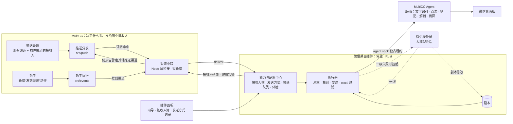

# 微信桌面提醒技术方案（第五版）

版本：第五版，2026 年 10 月 28 日，取代第四版。第五版重新定位插件：插件是 MultiCC 和微信之间的能力与配置中心，发给谁、怎么发由你配置（第四节、第十节）。第四版加入的“大模型接管与剧本修补”（第九节）保持不变。

状态：第五版已于 2026-10-28 经你确认，第零阶段验证进行中（结果见 12.1）。代码尚未实现。标“已有”的内容已对照当前代码或本机状态核实，并给出位置；标“拟新增”的为提案。仓库路径相对于项目根目录。

## 一、结论

1. **只做一个渠道。** 渠道就是“控制电脑操作微信桌面版”，只支持 macOS。不接企业微信、第三方转发（Server 酱、PushPlus 等）或 iLink。
2. **插件是能力与配置中心，不替你决定发给谁。**
   - **插件管“能发给谁、怎么发”**：接收人簿（可以有多个接收人，每个都经过搜索、核对和手机确认）、发送方式（频率、静默时段、锁屏、大模型接管等），以及投递队列、健康状态、剧本。
   - **MultiCC 管“什么事、发给哪个接收人”**。有三个配置入口，共用插件里的接收人簿：
     - 插件面板，适合只想“出了问题就发我微信”的人；
     - 推送设置，和现有的 Bark、Webhook 并列；
     - 钩子，新增一个“发到渠道”动作，用来精确指定。
   - **这套约定是通用的。** 插件通过一个固定的“渠道接口”接入 MultiCC。推送设置和钩子不为微信写专门代码，以后飞书、钉钉桌面版插件按同样方式接入。
3. **三级执行：剧本优先，大模型兜底，人最后。**
   - **一级：剧本。** 由 Rust 写的“微信桌面插件”按剧本执行，MultiCC Agent 负责操作。每一步都用本机文字识别核对屏幕，对不上就停。这一级不调用模型，截图也不离开本机。
   - **二级：大模型接管。** 剧本在“按发送键”之前失败，并且失败属于界面意外（找不到预期文字、出现没见过的弹窗、进错会话等），就交给一个大模型会话来操作。
   - **三级：你。** 大模型也处理不了，或者失败本身需要人来处理（例如输入框里有你的草稿、需要扫码登录），就推送给你。
4. **发送键始终握在执行器手里。** 大模型只负责把微信带到“目标会话已打开、输入框为空”的状态。粘贴正文、核对和按发送键都由执行器完成，核对标准与一级完全相同。大模型的每个操作都要经插件过滤后才转给 Agent，发送类按键会被直接拒绝。
5. **大模型可以修改剧本，但改的是数据，不是程序。** 剧本是一份带版本号的步骤清单，大模型只能改其中的关键词、区域、偏移、等待时间等参数。改完要经过格式检查、录像回放和实地演练才能生效；新增步骤需要你批准；出问题会自动退回上一版。
6. **三个难点各自成套：**
   - **配置引导**：插件面板里的四步向导，用来接好微信、添加接收人。每个检查项都有状态、原因、一键处理和“重新检测”。最后真实发一条测试消息，并由你在手机上确认收到、确认有提醒声。
   - **危险检测**：分三层，分别是发送前体检、发送中逐步核对、后台持续巡检。巡检发现的问题通过 MultiCC 页面和现有的 App 推送告诉你，不用微信报微信自己的故障。
   - **锁屏**：把“锁屏发送能力”分成四档显示。需要锁屏发送时，按“解锁 → 发送 → 立即重新锁屏 → 确认已锁回”执行。解锁失败一次就停用这项能力，避免反复尝试错误密码。
7. **有一个事实要在配置时讲清。** Mac 上登录的是哪个微信号，消息就以哪个号的身份发出；发给这个号自己，或发到它所在的群，这个号的手机通常不会响。插件在添加接收人前说明这一点，并用手机确认来核实。用哪个号、发给谁，由你决定。
8. **本期范围。** 不另建通知引擎。微信作为一个渠道接入现有推送（`src/push/`）和现有钩子（`src/events/`），这两处现有渠道和动作的行为都不变。合并、限频、推迟等微信专用的发送逻辑放在插件里。
9. **分发方式。** 微信插件是独立项目，不进 MultiCC 仓库，也不随 MultiCC 安装包分发；需要的人自己装到 `plugins/` 目录（插件系统现有的“复制进来即安装”）。MultiCC 主包只加和微信无关的通用能力：插件常驻与渠道声明、推送的插件渠道、钩子的“发到渠道”、Agent 的 `lease` 指令。

## 二、版本差异

第五版相对第四版：

| 第四版 | 第五版 | 原因 |
| --- | --- | --- |
| 另建一个 Rust 精简通知引擎，自带提醒规则 | 不另建引擎。什么事发给谁，在推送设置和钩子里配置；微信作为渠道接入 | 用户要求：插件是能力与配置中心，具体发给谁、怎么发由用户配置 |
| 只有一个接收人，方案里列为“待你决定” | 插件里有接收人簿，可以添加多个；不同的事可以发给不同的人 | 接收人是配置项，不是设计决定 |
| 剧本生效方式、接管用的模型列为“待你决定” | 都是插件的发送方式设置，带推荐默认值 | 同上 |
| 合并、限频、投递队列放在通知引擎 | 放在插件里，对所有入口一视同仁 | 这些是微信专用的发送逻辑；账号安全的底线不能被钩子绕过 |
| 插件按次调用 | 插件常驻运行（插件系统拟新增能力） | 一次发送最长 4 分钟，还要定时巡检、推迟发送，按次调用的 20 秒上限做不到 |
| 插件放进 MultiCC 仓库，随主包分发 | 独立项目，单独安装，MultiCC 仓库里没有任何微信代码 | 用户要求：微信提醒不是每个 MultiCC 用户都需要 |
| Agent 新增 `ocr`、`paste`、`lock`、`humanIdleSeconds` | Agent 只加通用的 `lease`；文字识别、剪贴板、锁屏、空闲时长都在插件里做（8.1） | Agent 随主包分发，只放通用能力；插件需要的这几项都不需要额外的系统权限 |

第四版相对第三版：

| 第三版 | 第四版 | 原因 |
| --- | --- | --- |
| 发送全程不用大模型；剧本失败就停，交给你 | 剧本失败后先由大模型接管，再交给你 | 旧中转的记录显示，微信界面上的意外很常见，大模型多数能处理（9.1） |
| 插件内置“已验证版本表”，界面变了要等插件升级 | 剧本独立成带版本的数据文件，大模型可以修补，有检查、演练和回滚 | 不用等升级插件，界面小改动能当天修好 |
| — | 每天在你离开电脑时演练一次，失败就提前修 | 不要等到真提醒来时才发现剧本坏了 |

第三版相对第二版：

| 第二版 | 第三版 | 原因 |
| --- | --- | --- |
| 统一通知管道，现有推送分阶段迁入 | 只做微信桌面；现有推送不迁移，只用来报告健康问题 | 用户决定只做控制电脑的微信操作 |
| webhook 模板、企业微信应用消息为首批渠道 | 不做 | 同上 |
| 桌面中转为实验性，结果只到“已交给中转” | 桌面发送是主线，改为确定性发送器，结果可到“已在微信提交” | 现有中转靠大模型看截图、坐标写死、会覆盖剪贴板，还会把截图发给模型服务商 |
| “仓库没有桌面互斥” | 更正：Agent 有会话级租约，同一时刻只允许一个会话操作键鼠 | `scripts/macos-agent/MultiCCAgent.swift:1137`、`:1247` |
| 配置、危险、锁屏只写了几行 | 这三块各占一节，是本方案的主体 | 用户确定的核心难点 |

## 三、现状

### 3.1 MultiCC Agent（`scripts/macos-agent/MultiCCAgent.swift`）

已有能力：

| 能力 | 位置 | 说明 |
| --- | --- | --- |
| 状态查询 | `:1501` | 辅助功能、屏幕录制、事件发送三项权限；是否锁屏；是否已存解锁密码；关盖守卫；控制状态 |
| 请求权限 | `:1519` | 打开系统设置中对应的权限页 |
| 锁屏判定 | `:339` | 依据 `CGSSessionScreenIsLocked` |
| 自动解锁 | `:639` | 用辅助功能把密码填进锁屏密码框并提交，再确认已解锁；未允许、无密码、钥匙串未授权时拒绝 |
| 是否允许自动解锁 | `:363` | 开了“关盖运行”即允许，否则看“允许自动解锁”设置 |
| 会话租约 | `:1137`、`:1247` | 120 秒租约，期间别的会话收到 busy；`release` 可提前释放（`:1524`） |
| 操作闸门 | `:1247` | 未授权、已锁屏、按过 Esc、别的会话占用、受保护应用（系统设置、钥匙串、登录窗口等，`:1234`）都会拒绝；单次操作最多排队 15 秒 |
| 输入文字 | `:159` | 用 Unicode 键盘事件输入中文，不经过剪贴板 |
| 无障碍树查看 | `see` | 对微信无效：微信几乎不暴露界面元素 |

缺少的能力：

| 能力 | 现状 |
| --- | --- |
| 文字识别 | 没有。`click-text` 只匹配无障碍树里的文字，而微信不暴露这些文字 |
| 重新锁屏 | 没有这个操作 |
| 判断真人是否在用电脑 | 没有。`:985` 的注释写明，Agent 有意不把键鼠活动当作“用户在用”，因为它分不清自己的操作和真人操作 |
| 保留剪贴板的粘贴 | 没有 |
| 识别微信状态 | 没有 |
| 只占住、不操作的租约 | 没有。租约只在一次键鼠操作开始时取得，每次操作续期 120 秒（`:1195`–`:1217`）；中途 120 秒没有操作就会过期 |

### 3.2 自动解锁与电源（已有）

- **接口**：`GET /api/settings/power` 在 `src/routes/host-read.js:255`；自动解锁开关在 `src/routes/host-power.js:47`；“确认授权”在 `:87`。
- **钥匙串授权探测**：由 `src/macos-unlock-probe.js` 实现，有四种状态：已授权、等你在系统框里点“始终允许”、没有密码、Agent 不可用。
- **设置入口**：只在 Web 的 Air 全局设置里。App 端没有这两项设置。

### 3.3 现有微信中转（`~/.multicc/wechat-alert/`）

| 问题 | 依据 |
| --- | --- |
| 窗口位置写死，挪动就停 | `relay-prompt.md:24`：屏幕逻辑分辨率 1470×956，窗口必须是 109,182,941,640 |
| 搜索结果按固定行点击，换个搜索词就得重新量 | `relay-prompt.md:58-62` |
| 核对群名靠模型看截图 | 微信聊天截图会发给模型服务商 |
| 粘贴会覆盖剪贴板，且不恢复 | `relay-prompt.md:90` |
| 每条消息都消耗一次模型调用 | 中转是完整的模型会话 |
| 模型会改写自己的提示词 | 2026-09-27 换群时发生过 |
| 模型接口出错时，这一轮就发不出 | 371 张工单里有 38 张（9.1） |
| 会自己决定不发 | 多次以“同一任务刚发过”为由不发，超出它的职责（9.1） |

中转三周的完整运行统计见 9.1。它也说明了大模型的长处：遇到界面意外时，多数情况它能自己绕过去。

### 3.4 本机实况（2026-10-28 只读查看）

- 定时规则 `cron_pd7tafzgciuq`（异常任务微信提醒）已停用，最后一次运行在 2026-10-17 14:19。**目前没有任何微信提醒在运行。**
- 停用前的发送记录里，同一个整点运行的任务每小时出错一次、就提醒一次。新方案需要“重复出错抑制”。
- 2026-10-28 上午 Agent 的三项权限全部为 `false`。Agent 日志显示，10 月 26 日之前每次启动都是 `true`。原因不是授权被撤销，而是 Agent 被重装成了临时签名，和系统里按开发者签名记的授权对不上（详见 12.1）；已重签恢复。
- 解锁密码已存进钥匙串，但“允许自动解锁”和“关盖运行”都是关闭状态。

结论：照现在的状态发起一次锁屏发送，第一步就会失败，而且没有任何地方提前告诉你。第六节的后台巡检就是为这种情况设计的。

### 3.5 可以接入的三个位置（已有）

| 位置 | 现状 | 缺什么 |
| --- | --- | --- |
| 插件系统（`plugins/README.md`、`src/routes/plugins.js`） | 一个插件是一个文件夹，带 `plugin.json` 清单和命令白名单；面板页嵌在 Air「资料与插件 → 插件」里；运行数据放在 `~/.multicc/plugins-data/<插件>/`（已登记在 `governance/runtime-write-inventory.json`）。调用方式是按次启动插件程序，单次上限 20 秒（`src/routes/plugins.js:27`） | 插件不能常驻运行；插件没法声明“我是一个通知渠道”；推送设置和钩子拿不到插件里的接收人 |
| 推送（`src/push/`） | `runtime.js:247` 的 `notify()` 把同一条推送同时发给网页推送、FCM、Bark、Webhook（`:283`–`:292`）；同一会话 8 秒内只推一次；推送分类为完成、等你、等后台、出错（`notification-copy.js`）；用户主动取消时不推送（`src/classify/state-machine.js:408`）。设置页是 `public/air-push.js`，Bark 已支持多台设备（`bark-devices.js`） | 没有“插件渠道”这一类；每个渠道收到的都是全部分类，不能只收某几类 |
| 钩子（`src/events/`） | 规则 = 事件 + 过滤 + 动作。动作有三种：注入提示词、Webhook、推送（`rules.js:11`）；过滤可以按任务、项目、目标状态、是否取消（`rules.js:103`–`:106`）；规则可以是全局的，也可以挂在单个任务上。编辑界面是 `public/hook-editor.js` 和 `public/air-trigger-center.js` | 没有“发给某个接收人”的动作。现有的“推送”动作会发给所有推送渠道 |

## 四、架构



**三个入口，两份路由，一本接收人簿：**

| 入口 | 配置什么 | 路由存在哪 |
| --- | --- | --- |
| 插件面板 | 接好微信、管理接收人、设置发送方式；“快速接入”一栏可以直接把某个接收人加进推送，和推送设置里改是同一件事 | 写进推送设置 |
| 推送设置 | 微信作为一个渠道，和 Bark、Webhook 并列；每个接收人单独勾选要收哪几类推送 | 推送的渠道订阅 |
| 钩子 | 新增“发到渠道”动作：某个事件、满足某些过滤条件时，发给指定接收人；可以是全局规则，也可以挂在单个任务上 | 钩子规则 |

接收人只在插件里添加和核对，推送设置和钩子都只能从插件已有的接收人里选。

| 组件 | 负责 | 不负责 |
| --- | --- | --- |
| 推送设置、钩子（已有，小改） | 什么事、发给哪个接收人 | 怎么发 |
| 渠道中转（Node，拟新增） | 管理常驻插件的启动、停止和崩溃重启；把推送和钩子的投递转给插件；向设置页提供各插件的接收人列表；把插件的健康告警交给其他推送渠道 | 任何微信逻辑 |
| 微信桌面插件（Rust，常驻） | 接收人簿、发送方式、投递队列（合并、去重、限频、推迟）、体检与巡检；执行剧本、核对与发送；接管时作为大模型的过滤代理；剧本的检查、回放、演练、生效与回滚 | 判断哪类事该发给谁 |
| 剧本（数据文件） | 微信界面知识：关键词、区域比例、偏移、等待、布局分支 | 核对与发送（写死在插件里） |
| 微信操作员（大模型会话） | 一级失败后，把微信带到“就绪状态”；提出剧本修改 | 粘贴正文、按发送键、判断该不该发 |
| MultiCC Agent（Swift） | 通用能力：文字识别、点击、粘贴、解锁、锁屏、状态 | 认识微信 |

几个取舍：

- **为什么做成插件，而不是写进 Agent 或 MultiCC**：微信界面会随版本变化，插件可以单独升级、单独卸载。渠道接口是通用的（10.1），以后飞书、钉钉桌面版提醒也做成同类插件，推送设置和钩子不用改。
- **为什么合并、限频放在插件里，而不是推送或钩子里**：这些是“怎么发”，而且是账号安全的底线。放在插件里，不管消息从哪个入口来都受同一套限制，钩子写错了也不会把微信刷爆。
- **大模型放在哪一层**：平时不用它。危险检测要求结果可预期、可复现，发送过程也不应把截图发给模型服务商，所以一级完全不调用模型。大模型只在一级遇到界面意外时出场，而且只负责“把微信带到就绪状态”，发不发、发什么、按不按发送键都由执行器决定。
- **为什么 Agent 用 Swift**：文字识别、锁屏、解锁都依赖 macOS 系统框架，Agent 本来就是 Swift 写的原生组件。插件的业务逻辑在 Rust，Node 只做接入层。
- **为什么插件要常驻**：一次发送最长 4 分钟（含接管），还要排队推迟、每 15 分钟巡检、每天演练，按次调用的 20 秒上限做不到。常驻是插件系统新增的通用能力（10.1），插件通过 `agent.sock` 调用 Agent。

## 五、配置引导（难点一）

入口在插件面板：Air「资料与插件 → 插件 → 微信桌面提醒」。首次进入是四步向导，配置完成后面板分为四块：体检卡片、接收人簿、发送方式、发送记录（含接管回放和剧本版本）。

推送设置里的微信一栏和钩子编辑器里的“发到渠道”，在插件还没配好时都显示“先到插件面板完成配置”，并附跳转链接。

每个检查项都显示四样东西：状态（通过 / 未通过 / 检测中）、一句话原因、一个处理按钮、“重新检测”。任何一项未通过时，后面步骤里依赖它的操作按钮都不可点，旁边写明原因。

### 第 1 步：电脑准备

| 检查项 | 怎么判断 | 未通过时的提示与操作 |
| --- | --- | --- |
| 系统 | 当前平台 | 只支持 macOS |
| MultiCC Agent 在运行 | Agent 状态查询 | “安装并启动 Agent”按钮，复用现有安装流程 |
| 辅助功能权限 | 状态中的 `accessibility` | “去授权”：打开系统设置对应页面，页面每 2 秒检测一次，变绿即通过 |
| 屏幕录制权限 | `screenRecording` | 同上 |
| 事件发送权限 | `postEvents` | 同上 |
| 系统不会睡眠 | `GET /api/settings/power` 中的 `systemSleepDisabled` | 说明 Mac 睡眠时 MultiCC 本身不运行，什么都发不出 |
| 锁屏发送能力 | 第七节的分档 | 显示当前档位，以及升到下一档还缺哪一项 |

授权项旁边常驻一句提示：“MultiCC Agent 更新后，可能需要重新授权。”

### 第 2 步：微信准备

| 检查项 | 怎么判断 | 未通过时 |
| --- | --- | --- |
| 微信已安装 | 应用是否存在 | 引导安装 |
| 微信在运行 | 主进程是否存在 | “启动微信”按钮 |
| 已登录 | 插件体检：根据窗口尺寸，加上文字识别关键词，区分登录页、主界面、更新弹窗 | 提示去 Mac 上扫码登录；这一步无法代办 |
| 微信版本 | 读取应用版本 | 与上次演练时的版本不同，就显示“版本已变化，正在安排演练”（9.6） |
| 发送键 | 让你选择“Enter 发送”还是“⌘+Enter 发送”，第 3 步的测试发送会核实 | 测试未通过，就提示到微信设置里核对 |

**须知**（阅读并勾选“我已了解”后才能继续）：

- 消息以 Mac 上登录的这个微信号的身份发出。发给这个号自己，或者发到它所在的群时，这个号的手机通常不会响铃提醒；别的成员会正常收到。
- 自动操作微信可能不符合微信的使用规则，登录的这个号存在被限制的风险。本功能默认低频发送（见本节第 4 步）。

用哪个号登录、发给谁，由你决定。插件只说明后果，并在第 3 步用手机确认来核实。

### 第 3 步：添加接收人（可以重复添加）

接收人簿里可以有多个接收人，例如你自己、团队群、某个同事。每添加一个，都走一遍下面的流程：

1. **起名**：给接收人起一个你自己认得的名字，例如“我”“运营群”。推送设置和钩子里显示的就是这个名字。
2. **搜索**：你输入微信里的名称，插件在微信里搜索，返回候选列表，每项包括分类（群聊或联系人）、名称、截图裁剪。
3. **点选**：只接受精确同名且唯一的结果。
   - 出现同名或名称互相包含时，不允许“选第一个”。
   - 这时提示你给群改一个唯一名称，或者换一个接收人。
4. **记录绑定**：名称、类型、识别出的标题文字（“识别指纹”）、群人数后缀规则（例如 `(5)`）、绑定时的截图。以后核对标题时，先和识别指纹比，比不上再按 6.2 的形近字规则和名称比。
5. **测试发送**：发出一条“【测试】MultiCC 微信提醒 编号 xxxx”，全程按 6.2 的流程核对。
6. **手机确认**：页面询问“收到了吗？”，提供三个按钮：

   | 你的回答 | 处理 |
   | --- | --- |
   | 收到了，有提醒声 | 接收人标记为“已确认送达” |
   | 收到了，但没响 | 说明可能是发给了登录号自己，或该会话被设为免打扰；接收人照样可用，标记为“送达但不响”，由你决定是否保留 |
   | 没收到 | 显示这次发送每一步的记录和截图，供排查；接收人不可用 |

这个手机确认，是整个方案里唯一能证明“真的送到人”的环节。

**新接收人默认先演练 1 天。** 演练期间，发给它的投递只操作到“核对接收人”为止，不粘贴、不发送，每次都留下记录。演练成功率达标后，由你点“转为正式”；也可以跳过演练。演练同样只在你离开电脑时进行。

接收人簿里每个接收人都显示：状态（演练中、正式、已暂停、需要重新核对）、最近一次发送结果，以及**哪些推送订阅和钩子在用它**。删除前会列出这些引用；可以改为“暂停”。坚持删除时，引用它的钩子和推送订阅会标红，之后触发时各记一条失败。

微信里的群改名后，下一次发送会在搜索这一步停手，接收人标为“需要重新核对”，提示你更新名称。

### 第 4 步：发送方式与接入

发送方式对所有入口一视同仁，推送和钩子都不能改：

| 设置 | 默认值 |
| --- | --- |
| 你在电脑前时不发 | 开。屏幕未锁、且键鼠空闲不到 5 分钟时，就认为你在电脑前 |
| 静默时段 | 关，可设置 |
| 合并等待 | 60 秒 |
| 同一接收人最短间隔 | 5 分钟 |
| 发送上限 | 每小时 6 条，每天 40 条 |
| 重复出错抑制 | 同一任务 6 小时内再次出错，不再提醒 |
| 消息里带链接 | 关；需先配置手机能访问的地址 |
| 出错时请大模型接管 | 开。开启前需阅读并确认：接管时会把裁剪、打码后的微信截图发给所选模型（9.7） |
| 接管用的模型 | 你的默认线路；不支持看图时提示更换 |
| 每次发送前请大模型复核 | 关。打开后每次发送多一次模型调用，约多 5 到 10 秒（9.7） |
| 剧本修改何时生效 | 参数类修改通过检查和演练后自动生效，新增步骤需要你批准；可改为“所有修改都要我批准”（9.5） |
| 开盖锁屏时允许接管 | 关；合盖时允许（9.8） |
| 发送键 | 第 2 步选定的 Enter 或 ⌘+Enter |

“同一接收人最短间隔”和“静默时段”可以按接收人单独覆盖，例如团队群只在工作时间发。

**接入 MultiCC**：向导最后一屏给出两个入口。也可以都跳过，接收人簿照样保存，以后再接：

- **加到推送**：选一个接收人，勾选要收哪几类推送。默认只勾“出错了”和“在等你回答”，不勾“完成”和“等后台”。这和在推送设置里勾选是同一件事（10.3）。
- **新建钩子**：打开钩子编辑器，动作预选为“发到渠道 → 这个接收人”（10.4）。

消息由事件触发，接入之前已经存在的问题不补发。

### 体检卡片（常驻）

| 内容 | 显示什么 |
| --- | --- |
| Agent 与权限 | 是否在运行，三项权限 |
| 微信 | 登录状态、版本 |
| 接收人 | 正式、演练中、需要重新核对的各有几个 |
| 接入情况 | 几个推送订阅、几条钩子在用本插件；其他推送渠道是否还开着（6.4） |
| 锁屏发送能力 | 当前档位 |
| 最近一次发送 | 结果和时间 |
| 最近一次演练 | 结果和时间 |
| 剧本 | 当前版本（稳定版或候选版）、最近一次修改的原因，待你批准的修改 |
| 最近一次接管 | 结果、用时，是否产生了剧本修改 |
| 巡检 | 下次巡检时间 |

任一项变红：页面顶部出现横幅，并通过现有 App 推送告诉你（见 6.4）。

## 六、危险检测（难点二）

分三层：

| 层 | 什么时候 | 解决什么 |
| --- | --- | --- |
| 发送前体检 | 每次发送前 | 现在适不适合动这台电脑 |
| 发送中逐步核对 | 每一步操作后 | 有没有点错、发错 |
| 后台持续巡检 | 不发送时也在跑 | 提前发现“到时候会发不出” |

### 6.1 发送前体检

每次发送前跑一遍，耗时约 1 秒，不操作键鼠。

| 危险 | 检测 | 处理 |
| --- | --- | --- |
| Agent 不在，或权限缺失 | Agent 状态 | 标为“需要你处理”，并触发巡检告警 |
| 你正在用电脑 | 屏幕未锁，且键鼠空闲不足 5 分钟（插件读取系统空闲时长，在让 Agent 做任何操作之前读取，见 8.1） | 推迟到你离开；推迟期间问题已解决的，就不再发 |
| 你在远程控制这台 Mac，或别的会话在操作电脑 | Agent 租约持有者 | 推迟 |
| 你按过 Esc，或点了暂停条 | Agent 控制状态 | 推迟并提示；不自行恢复 |
| 前台是会议或投屏应用 | 前台应用名单（腾讯会议、飞书会议、钉钉会议、Zoom、Teams 等，可配置） | 推迟，避免在共享屏幕时弹出微信 |
| 刚开机还没登录，或切换到了别的 macOS 用户 | 当前控制台用户 | 跳过，标为“需要你处理” |
| 屏幕锁着 | 见第七节 | 见第七节 |
| 微信未运行、未登录、有已知弹窗 | 插件体检 | 未运行时尝试启动一次；已知弹窗由剧本关闭；未登录标为“需要你处理” |
| 超出频率、每日上限，或处于静默时段 | 插件的发送方式设置 | 推迟 |
| 接收人已暂停或已删除 | 接收人簿 | 不发，记一条失败，指明是哪个推送订阅或钩子引用了它 |

### 6.2 发送中逐步核对

每一步之前都检查 Esc 和暂停条。

| 步骤 | 核对内容 | 不通过时 |
| --- | --- | --- |
| 1. 激活微信 | 前台是微信主进程，窗口在屏幕上；窗口位置每次实时读取，不写死 | 停手 |
| 2. 搜索接收人 | 同一分类下恰好有一个精确同名的结果 | 停手（找不到或不唯一） |
| 3. 进入会话 | 标题识别结果等于识别指纹或绑定名称（忽略人数后缀，按下方形近字规则比较） | 停手 |
| 4. 草稿检查 | 输入框识别为空 | 停手，原因：“输入框里有你还没发出的草稿，为免一起发出已停止” |
| 5. 粘贴 | 先保存剪贴板、粘贴、再恢复剪贴板；输入框识别出正文首行和编号 | 清掉刚粘贴的内容后停手 |
| 6. 发送前复核 | 再核对一次前台应用和会话标题 | 清掉粘贴内容后停手 |
| 7. 按发送键 | **提交点** | — |
| 8. 发送后核对 | 聊天区最后一条消息里识别出本次编号 | 识别到为“已在微信提交”，否则为“结果不明” |
| 9. 恢复现场 | 恢复原来的前台应用，恢复微信原来是否隐藏；原来锁着的重新锁屏（第七节） | 恢复失败要记录；锁屏失败为最高级告警 |

**形近字规则**（依据 12.1 第 1 项的实测）：

- 只用 Vision 的 `accurate` 档；`fast` 档基本不认中文。
- 比较前，两边做同样的归一化：去掉空格和表情；全角括号转半角；`·`、`•`、`．` 一律去掉；`I`、`l`、`1`、`|` 视为同一个字符；`α` 视为 `a`。
- 搜索结果里如果有两个名称归一化后相同（例如“AI群”和“Al群”），就当作“接收人不唯一”，停手。
- 认错只会导致“对不上就停手”，不会导致发错人：搜索结果必须唯一、标题必须一致，两道核对都通过才继续。

失败后的去向：

- **在提交点之前失败**：可以确定没发出，然后按失败类型分流（详见 9.2）：
  - 属于界面意外的，交给大模型接管；
  - 必须由人处理的，例如草稿、接收人不唯一、未登录、权限缺失，交给你；
  - 时机不对的，例如你在用电脑、桌面被占用，就推迟。
  - 一张投递单最多走一次接管；剧本自身的自动重试最多 3 次，而且只在你离开电脑时进行。
- **在提交点之后**：一律不自动重试，也不交给大模型。“结果不明”的投递附上截图，由你决定是否重发。

还有一项待验证：发送过程中检测到真人动了键鼠就立即停手。旧中转的记录说明，这不能靠系统的空闲计时来判断，因为 Agent 自己的点击也会把空闲计时清零：旧版 mcu 的“空闲 30 秒才放行”守卫因此反复卡住自己，后来被删掉了（`MultiCCAgent.swift:985` 的注释）。第零阶段要实测能否按事件来源区分真人输入和 Agent 输入；做不到的话，只保留发送前判断和 Esc。旧中转确实出过这类事：它的一次点击打断了你正在输入的拼音，在别的会话里留下了残字草稿。所以“你在电脑前时不发”默认开启。

### 6.3 发送器的硬性限制

- 只往接收人簿里已核对的接收人发，只发投递队列给出的定稿正文。
- 不点击其他会话里的任何东西，不打开链接、不处理文件、不改微信设置。
- 窗口、标题、搜索结果，任何一处与预期不符，剧本就停手，不尝试“绕过去”。要绕，交给大模型，而且发送键仍握在执行器手里（第九节）。
- 每一步的截图都保存在本机私有目录，保留 7 天；文字识别在本机完成。只有大模型接管时，才把裁剪、打码后的截图发给模型服务商（9.7）。

### 6.4 后台持续巡检

**什么时候巡检**：
- MultiCC 启动时；
- 每 15 分钟一次；
- Mac 唤醒或解锁后；
- Agent 版本或签名变化后；
- 微信版本变化后。

每天一次的剧本演练和失败后的提前修补见 9.6。剧本处于“待你批准”或“已失效、自动修补未成功”时，也算体检不通过。

**检查什么**：
- Agent 是否在运行，三项权限；
- 解锁密码是否已存、钥匙串是否已授权、是否允许自动解锁；
- 关盖运行是否打开、当前盖子状态；
- 微信是否登录；
- 系统睡眠设置。

**怎么告警**：
- 插件把告警交给渠道中转，由中转通过 MultiCC 页面横幅和推送的其他渠道（网页推送、FCM、Bark、Webhook）发出。
- 同一个问题只告警一次，恢复后再出现才会再次告警。
- **不用微信报微信的故障。** 如果你在推送设置里只留了微信、关掉了其他渠道，插件面板和推送设置都会提示：插件自身出故障时，只能在页面上看到。
- 插件进程本身停止运行（崩溃、被卸载）时，由渠道中转发现并告警，同样走其他渠道。

第 3.4 节的权限丢失就是典型场景：开机时时钟不对，Agent 被重装成临时签名，授权随之失效。巡检应在 15 分钟内发现，并推送到你的手机。安装脚本不该在这种情况下降级签名，这个问题单独修（12.1）。

### 6.5 账号风控

- 默认低频（见第五节第 4 步），上限对所有入口生效，推送和钩子都绕不过去。
- 多个任务合并成一条消息，相同内容不重复发送；同一件事被推送和钩子同时命中，同一个接收人也只收一条（10.5）。
- 默认不带外部链接。
- 发送行为保持固定节奏，只发给接收人簿里已核对的接收人。

## 七、锁屏、熄屏与自动解锁（难点三）

### 7.1 锁屏发送能力分四档

| 档位 | 含义 | 需要的条件 |
| --- | --- | --- |
| 不可用 | 发不出去 | 原因可能是：Agent 权限缺失、系统会睡眠、微信不可用 |
| 一档 | 只在屏幕未锁时发 | 第五节第 1、2 步全部通过 |
| 二档 | 锁屏时也能发 | 允许自动解锁已打开；解锁密码已存；钥匙串状态为“已授权”；锁屏实测通过 |
| 三档 | 合上盖子也能发 | 二档的条件，加上“关盖运行”已打开（合盖时 Agent 关掉背光，桌面保持可以操作） |

页面显示当前档位、还缺哪一项，以及对应的按钮。这些按钮直接复用 Air 全局设置里已有的“自动解锁”“确认授权”“关盖运行”。

### 7.2 状态怎么判断

| 状态 | 判断依据 | 注意 |
| --- | --- | --- |
| 是否锁屏 | 只看 `CGSSessionScreenIsLocked` | 屏幕亮着时，锁屏界面的截图并不是黑的，不能拿截图判断 |
| 屏幕是否熄灭 | 电源断言 | 熄屏时截图是黑帧 |
| 盖子是否合上 | `AppleClamshellState` | — |
| 系统是否睡眠 | — | 系统睡眠时 MultiCC 本身不运行，只能靠“系统不睡眠”的设置来保证 |

### 7.3 锁屏发送流程

1. 记录原始状态：是否锁屏、是否熄屏、背光、当前前台应用。
2. 屏幕熄灭时先唤醒。
3. 调用 Agent 现有的解锁能力，并确认已经解锁。
4. 执行第六节 6.2 的发送流程。
5. **无论发送成功与否，立即重新锁屏**（插件内实现，见 8.1），并确认已锁回。
6. 恢复熄屏和背光状态。

只走剧本时，从解锁到锁回目标控制在 30 秒以内；如果需要大模型接管，总时长上限 4 分钟，到点先锁回，再交给你（9.8）。**原来是锁着的，就一定锁回去**，即使发送中途有人动了电脑也一样：解锁这件事必须由人自己来做。

### 7.4 失败处理

| 情况 | 处理 |
| --- | --- |
| 解锁后仍是锁屏（密码可能改了） | 只尝试这一次。立即停用锁屏发送，告警“解锁密码可能已变更，请到设置里重新保存”。不重试，以免触发系统对密码输错的等待惩罚 |
| 钥匙串未授权 | 标为“需要你处理”，提示到设置里点“确认授权” |
| 没有解锁密码，或未允许自动解锁 | 能力降到一档；锁屏期间的提醒推迟到你下次解锁后 |
| **重新锁屏失败** | 最高级告警：这台 Mac 处于解锁状态。立即发 App 推送，并每分钟重试锁屏直到成功 |

### 7.5 安全提示

开启二档、三档前，必须展示以下说明并确认：

- 自动解锁意味着 MultiCC 可以用你的登录密码解锁这台 Mac。
- 解锁的十几秒里，旁边的人能看到屏幕内容。合盖时背光是关的，这个风险会小很多。
- 只建议在你信任的环境下开启。
- 登录密码只保存在系统钥匙串里，不进入 MultiCC 的保险箱。

### 7.6 锁屏实测（向导按钮）

- **锁屏实测**：点“锁屏实测”后，Agent 立即锁屏；10 秒后，对你选的一个接收人做一次测试发送（解锁 → 发送 → 锁回）；页面列出每一步的结果。通过后，能力才标为二档。
- **合盖实测**：提示你合上盖子 1 分钟再打开，然后查看结果。通过后标为三档。

## 八、发送器设计

### 8.1 能力分工：Agent 只加一项，其余在插件里

Agent 随 MultiCC 主包分发，所以只加通用能力。需要系统权限的事（截图、点击、按键、解锁）仍然只由 Agent 做；不需要权限的事放在插件里，主包里不出现任何微信相关的东西。

**Agent 新增（主包，通用）：**

| 能力 | 说明 |
| --- | --- |
| `lease` | 只占住租约、续期、释放，不做任何键鼠操作（8.3、12.1 第 8 项）。沿用现有闸门：Esc、受保护应用 |

**插件用 Agent 现有指令完成的：**

| 能力 | 做法 |
| --- | --- |
| 窗口位置 | Agent 现有的 `see`（指定微信）返回窗口位置，每次实时读取 |
| 截图 | Agent 现有的 `snap` 按窗口区域截成 PNG，存到插件的私有目录。第 1 步已把微信放到前台，后面每步都核对前台，所以不需要“被遮挡也能截”的窗口截图 |
| 点击、按键 | Agent 现有的 `click`、`key` |
| 解锁、锁屏状态 | Agent 现有的 `unlock` 和 `status` 里的 `screenLocked` |

**插件自己做的（都不需要额外的系统权限）：**

| 能力 | 做法 |
| --- | --- |
| 文字识别 | 对 `snap` 得到的 PNG 调用系统 Vision 框架，`accurate` 档，在本机完成（12.1 第 1 项） |
| 保留剪贴板的粘贴 | 保存剪贴板全部内容 → 写入正文 → 让 Agent 按 ⌘V → 恢复剪贴板 |
| 锁屏 | 调用系统的立即锁屏，再用 `status` 确认已锁上；可靠性在第零阶段第 3 项验证，不可靠再考虑给 Agent 加 |
| 真人空闲时长 | 读取系统的键鼠空闲秒数，在让 Agent 做任何操作之前读取 |
| 当前控制台用户、前台应用 | 读取系统信息 |

### 8.2 插件命令（`plugins/wechat-desktop-notify/`）

| 命令 | 输入 | 输出 |
| --- | --- | --- |
| `describe` | — | 支持的平台、当前剧本版本、上次演练通过时的微信版本 |
| `probe` | — | 微信是否在运行、是否登录、有无弹窗、版本、窗口位置 |
| `locate` | 名称 | 搜索候选列表（含截图裁剪），用于第五节第 3 步 |
| `send` | 投递编号、尝试编号、接收人绑定、正文、发送键、是否允许解锁、是否允许接管 | 结果、走到了第几级、是否越过提交点、每一步的记录、证据截图路径 |
| `rehearse` | 同 `send` | 只执行到核对接收人为止，不粘贴、不发送；失败时可以按演练模式接管（9.6） |
| `wxctl` | 见 9.3 | 给大模型用的受限命令，只在接管期间有效 |
| `playbook` | `check` / `replay` / `promote` / `rollback` | 剧本的检查、录像回放、生效、回滚（9.5） |

### 8.3 关键做法

- **不写死位置**：窗口位置每次实时读取。点击坐标由“识别出的文字位置”或“窗口内的相对比例”算出；搜索结果按识别出的文字定位。
- **占住、用完即还**：第一步用 Agent 新增的 `lease` 指令占住租约，不做任何键鼠操作。等待期间（例如接管时大模型在思考）每 30 秒续期一次；结束后立即释放，而不是让租约空占 120 秒。会话名每次随机生成，不告诉大模型（9.3）。
- **交给你之前先释放租约**：你的远程操控也走同一套租约。插件占着租约时，你远程点击会被拒绝（`MultiCCAgent.swift:1254`）。所以推送“需要你处理”之前，插件必须先释放租约。
- **时间上限**：只走剧本时，单次发送不超过 60 秒；加上接管，整体不超过 4 分钟。超时后，按是否越过提交点来判定结果。
- **界面知识放在剧本里**：关键词、区域、偏移、等待时间、布局分支都写在剧本文件里（9.4），不写死在插件代码中。插件升级只在需要新的操作类型时才有必要。

### 8.4 从旧中转记录里学到的必备处理

这些情况在旧中转里都实际发生过（9.1），剧本第一版就要覆盖，不能等大模型来救：

| 情况 | 剧本的做法 |
| --- | --- |
| 当前打开的是别的会话（旧群、别人的私聊） | 不看当前会话，永远从搜索进入 |
| 点会话列表时，列表因新消息重排，点进了别的会话 | 不点会话列表，只点搜索结果 |
| 搜索下拉框在两次操作之间自己关掉、被清空 | 聚焦搜索框、输入、识别结果、点击，在一次连续操作里完成 |
| 搜索结果的分组名变化（“群聊”和“最常使用”） | 按名称文字定位结果行，不依赖分组名和行号 |
| 窗口被挪动、被改宽 | 每次实时读取窗口位置 |
| “图片和视频”查看窗，或单独弹出的聊天窗盖在主窗口上 | 按窗口标题识别主窗口；遮挡窗口先按 Esc 关闭，关不掉就停 |
| 输入框里残留了上一条没发出去的提醒 | 按草稿处理，停手交给你。不用 ⌘A 清空，因为分不清那是谁的内容 |

## 九、大模型接管与剧本修补（第四版新增）

### 9.1 为什么需要：旧中转三周的记录

数据来自旧中转任务的聊天记录（`chat_history/task-dab7b68b49910a95ff55d7a0f1d4c083.json`），时间是 2026-09-27 到 10-17，共 371 张工单。统计按回复里的关键词粗略归类，个别条目可能归错。

| 情况 | 次数 | 说明 |
| --- | --- | --- |
| 回复“已发送” | 178 条回复 | 一条回复可能一次发出积压的多张工单 |
| 发送前发现当前会话不对，改走搜索后发出 | 至少 22 次 | 当前开着旧群“Mafit插件开发小组”或别人的私聊，最后一道目视核对拦了下来 |
| 点会话列表时列表重排，点进了别的会话 | 至少 4 次 | 都在粘贴前发现，重新进入后发出 |
| 窗口被改宽、被挪动，或被“图片和视频”查看窗盖住 | 多次，其中 4 次停手等人 | 提示词规定“窗口位置变了就停” |
| 搜索下拉框的分组和提示词写的不一样 | 多次 | 提示词写“群聊”分组，实际常是“最常使用”，模型按截图改点别处 |
| 模型接口出错，这一轮没发 | 38 张 | 例如 `ENOTFOUND api.deepseek.com` |
| 屏幕锁着 / 你在用电脑 / 键鼠被别的会话占用 | 25 / 23 / 3 张 | 正常推迟 |
| 影响到你 | 至少 4 次 | 一次点击打断了你正在输入的拼音，在别的会话留下残字草稿；一次误粘成草稿；一次把正文留在输入框；一次以为没发、其实已发出 |
| 自己决定不发 | 多次 | 以“同一任务刚发过”“工单比上一条旧”为由不发，超出它的职责 |
| 耗时（从工单到回复“已发送”） | 中位 79 秒，九成在 460 秒以内 | — |

结论：

- **大模型的长处是处理意外。** 上面那些会话不对、列表重排、分组变化，它多数能自己绕过去。纯剧本遇到没见过的情况只能停，你会频繁收到“需要你处理”。
- **大模型的短处是慢、会断、偶尔越权和扰民。** 约一成工单因模型接口出错没发；它会自己定规矩；它的点击会打断你。
- **所以分工是**：常见情况由剧本处理（8.4 已把上面这些意外写成剧本的必备处理）；剧本没见过的情况交给大模型；发送键始终握在执行器手里。

### 9.2 三级执行与分流

| 级 | 谁来做 | 什么时候 | 上限 |
| --- | --- | --- | --- |
| 一级：剧本 | 插件按剧本执行 | 每次 | 60 秒 |
| 二级：大模型接管 | 一个临时的“微信操作员”大模型会话 | 一级在提交点之前失败，且失败类型为“可接管” | 3 分钟、30 个命令、10 张截图 |
| 三级：你 | 页面横幅 + App 推送，附每一步记录、截图和远程操作链接 | 二级失败、失败类型要求人处理，或已越过提交点 | — |

一级失败时按类型分流：

| 失败类型 | 例子 | 交给 |
| --- | --- | --- |
| 可接管 | 找不到预期的文字；搜索结果样式变了；出现没见过的弹窗；微信窗口被别的窗口盖住；进错会话 | 大模型 |
| 必须由人处理 | 输入框里有你的草稿；接收人不唯一；微信未登录、需要扫码；Agent 权限缺失；解锁失败；锁回失败 | 你 |
| 时机不对 | 你在用电脑；桌面被别的会话占用；你按了 Esc 或暂停 | 推迟，不接管 |
| 已越过提交点 | 按下发送键后没识别到编号 | 你（结果不明，不重发） |

草稿归“必须由人处理”，是因为那是你的数据：大模型和剧本都不碰。

推送给你时附带 MultiCC 现有的远程操作链接，你可以在手机上直接操作这台 Mac 完成这一步。

### 9.3 发送键握在执行器手里

**就绪状态**定义为以下四条同时成立：

- 微信主窗口在前台；
- 打开的会话标题等于绑定名称（忽略人数后缀）；
- 输入框为空；
- 没有遮挡窗口。

接管流程：

1. 插件用一个随机生成、不告诉大模型的会话名，通过 `lease` 指令占住 Agent 租约，然后拉起操作员会话。接管期间每 30 秒续期，大模型思考再久，租约也不会过期。
2. 操作员只能使用 `wxctl` 命令。插件过滤每条命令，再用自己的租约转给 Agent。
3. 操作员认为已经就绪时，调用 `wxctl ready`。插件按一级的标准逐项核对，不通过就返回具体哪一项不符，操作员可以继续操作。
4. 核对通过后，由插件自己完成后续步骤：粘贴、复核、按发送键、核对编号（6.2 的第 5 到 9 步）。操作员到此结束。
5. 操作员如果绕过 `wxctl`、直接调用 Agent（例如 `mcu.sh`），会因为租约被插件占着而收到“别的会话正在使用”的拒绝。

`wxctl` 命令和限制：

| 命令 | 作用 | 限制 |
| --- | --- | --- |
| `snap` | 截取微信窗口 | 只截微信窗口；聊天内容区打码（9.7） |
| `ocr` | 识别微信窗口文字 | 打码区域不返回文字 |
| `click x y` | 左键单击 | 只能点微信窗口内部；不能点输入框和发送按钮所在区域；目标附近识别出“删除”“退出”“清空”“投诉”“转账”“红包”“发送”等字样时拒绝 |
| `type 文字` | 输入搜索词 | 只在上一次点击落在搜索框区域时允许；不能含换行；最长 50 字 |
| `press 键` | 按键 | 只允许 Esc、方向键、Tab、⌘F；拒绝 Return、Enter、⌘V、⌘A |
| `scroll` | 滚动 | 只在微信窗口内 |
| `ready` | 请插件核对就绪状态 | — |
| `giveup 原因` | 放弃，交给你 | — |

操作员看不到正文，不判断该不该发，也不能改正文。它不能点输入框，也就不会动到任何会话里的草稿，不会再出现打断你打字的情况（你在用电脑时本来也不会接管）。

### 9.4 剧本：大模型能改的“临时脚本”

剧本是一份带版本号的 JSON 文件：

- 初版随插件附带，放在插件目录的 `playbooks/base.json`；
- 修改后的版本放在 `${数据根目录}/notifications/playbooks/`。

剧本由固定的操作类型组合而成：

- `activate`：激活微信；
- `focusSearch`：聚焦搜索框；
- `typeQuery`：输入接收人名称；
- `waitText`：等待某段文字出现；
- `clickText`：点击识别出的文字；
- `clickRatio`：按窗口内的相对比例点击；
- `press`：按键，只限白名单；
- `closeCover`：关闭遮挡窗口；
- `branch`：根据识别到的文字选择分支。

示例：

```json
{
  "version": 13,
  "basedOn": 12,
  "reason": "搜索结果的分组名从“群聊”变成“最常使用”",
  "steps": [
    { "id": "activate", "op": "activate" },
    { "id": "cover", "op": "closeCover", "titles": ["图片和视频"], "optional": true },
    { "id": "search", "op": "focusSearch", "keys": "cmd+f" },
    { "id": "query", "op": "typeQuery" },
    { "id": "pick", "op": "clickText", "region": [0.0, 0.08, 0.35, 0.95],
      "match": "exact", "groups": ["群聊", "最常使用", "联系人"], "waitMs": 1400 }
  ],
  "regions": { "title": [0.36, 0.0, 1.0, 0.08], "input": [0.36, 0.82, 1.0, 1.0] }
}
```

核对（标题、输入框、前台）和发送不在剧本里，写死在插件代码中，剧本改不到。

| 大模型可以改 | 大模型不能改 |
| --- | --- |
| 界面关键词，例如分组名、弹窗标题 | 接收人绑定、正文 |
| 区域比例、点击偏移、等待时间 | 核对步骤和核对标准 |
| 增加关闭弹窗之类的步骤、增加布局分支（只能用已有的操作类型） | 粘贴、发送、提交点之后的一切 |
| — | 限频、静默时段、“你在电脑前不发”等规则 |

**为什么不让大模型直接写 shell 或 Python 脚本**：那样的脚本以 Agent 的辅助功能权限运行，等于可以操作整台电脑；而且没法用程序检查它有没有绕过核对。剧本只能组合固定的操作，插件逐步执行，每一步都在插件的过滤和核对之下。

需要新的操作类型时，必须升级插件，不能靠修改剧本得到。

### 9.5 修补流程

1. **写修改。** 接管成功后，插件把这次的命令记录、截图和识别结果交给同一个操作员会话，请它写出剧本修改，并用一句话说明界面哪里变了。
2. **格式检查。** 只改了允许的字段，操作类型都在白名单里。
3. **录像回放。** 用这次失败时录下的截图和识别结果离线运行新剧本，检查每一步能否找到目标。不动键鼠。
4. **实地演练。** 等你离开电脑时，用新剧本走到就绪状态为止，不粘贴、不发送。再往“文件传输助手”完整发一条测试消息（只有本号自己能看到），检查粘贴、发送和核对编号。
5. **生效。** 分两种：
   - 参数类修改（关键词、比例、偏移、等待）通过以上检查后，自动成为“候选版”；
   - 结构类修改（新增步骤或分支）需要你在页面上点“批准”。
   - 你也可以设置成所有修改都要你批准。
6. **转为稳定版。** 候选版连续 3 次真实发送成功后，转为稳定版。候选版只要失败一次，就自动退回上一个稳定版，再走一次接管。
7. **留痕。** 保留最近 20 个版本，页面上可以查看差异、一键回滚。每次修改在页面日志里记一条，不推送打扰你。
8. **防摆动。** 同一处 7 天内被改 3 次以上，就暂停自动修改，提示你检查。这通常说明界面在两种状态之间来回切换，应该加分支，而不是反复改参数。

### 9.6 提前修好，不等真提醒

- 每天在你离开电脑超过 10 分钟时，用剧本演练一次，走到就绪状态为止。微信或 Agent 版本变化后，也立即演练一次。
- 演练失败就按演练模式接管：目标同样是就绪状态，但不发送任何东西。接管成功后按 9.5 修补。
- 修补也失败时：页面横幅和 App 推送提示“剧本已失效，自动修补未成功，真实提醒会直接交给你”。
- 演练只在屏幕未锁时进行。合盖并开启锁屏发送时，也可以在锁屏状态下演练，同样是解锁、演练、锁回。

### 9.7 隐私、成本与复核模式

- **截图外发**：只在接管时发生。发出的截图只包含微信窗口；聊天内容区和会话列表里的消息预览默认打码，只保留会话名称、标题栏、搜索框和搜索结果、输入框区域。打码后模型还能否完成操作，第零阶段要验证。
- **开启方式**：接管必须由你在向导里明确开启，开启前展示上面的说明。
- **模型**：需要能看图的模型，在设置里选。
- **成本**：只在一级失败时调用模型，每次接管都有命令数和截图数上限。剧本修好后，同样的问题不再触发接管。
- **模型接口出错时**：不重试接管，直接交给你。投递单保持排队，下一次一级可用时再试（前提是问题还没解决）。
- **复核模式（可选，默认关）**：每次按发送键前，把裁剪后的标题栏和输入框截图交给模型，确认“会话是否为某某、输入框里是否就是这段正文”。模型说不对就停手。代价是每条多一次模型调用、多 5 到 10 秒；同时意味着每次发送都有截图外发。

### 9.8 锁屏时的接管

| 状态 | 默认 | 原因 |
| --- | --- | --- |
| 开盖锁屏（二档） | 不接管：一级失败就锁回，交给你 | 接管期间屏幕会在解锁状态停留最长 3 分钟，旁边的人能看到 |
| 合盖（三档） | 接管 | 背光关着，看不到屏幕 |

不论哪种，从解锁到锁回总共最多 4 分钟。到点先锁回，再交给你。

### 9.9 接管会话怎么运行

- **新会话**：插件向渠道中转发 `takeover` 消息（10.1），由中转通过 MultiCC 现有的派发接口拉起一个“微信操作员”任务会话。每次接管都用新会话，不保留跨次记忆。
- **提示词**：由插件生成，只读。内容包括：就绪状态的定义、接收人名称、这次失败的步骤和原因、当前剧本、`wxctl` 的用法和禁止事项。提示词里没有正文。
- **工具**：会话只开放 `wxctl`，通过 CLI 的工具白名单限制。即使白名单失效，Agent 租约和插件过滤仍然有效。
- **经验沉淀**：只通过剧本修改沉淀，不写会话记忆。旧中转会改写自己的提示词、自定“刚发过就不发”的规矩，原因就是它有跨次记忆，也能改写自己的规则。
- **记录**：每个命令、截图和核对结果都记入 `attempts`，页面上可以逐步回放。

## 十、提醒路由与投递

### 10.1 渠道接口（插件系统拟新增，通用）

任何插件都可以按这套约定成为一个通知渠道。推送设置和钩子只认这套约定，不为微信写专门代码。

**清单声明**：`plugin.json` 新增两项。

```json
{
  "engine": { "type": "command", "binary": "bin/wechat-desktop-notify", "resident": true },
  "channel": { "label": "微信", "labelEn": "WeChat", "platforms": ["darwin"] }
}
```

- `resident: true`：MultiCC 启动时把插件作为常驻进程拉起，崩溃后退避重启（1 秒、5 秒、30 秒，之后每 5 分钟一次）；插件被删除或停用时停止。插件面板的 `run` 命令照常可用，由渠道中转转给常驻进程，不再每次重新启动程序；超过 20 秒的操作（搜索接收人、测试发送）返回任务编号，面板轮询结果。
- `channel`：声明这是一个通知渠道。没有这一项的插件不会出现在推送设置和钩子里。

**常驻进程与 MultiCC 之间的消息**（本机套接字，每行一个 JSON）：

| 方向 | 消息 | 内容 |
| --- | --- | --- |
| MultiCC → 插件 | `targets` | 查询接收人列表：编号、你起的名字、状态。推送设置和钩子编辑器用它显示下拉框 |
| MultiCC → 插件 | `deliver` | 投递一件事（见下表），插件只回“已入队”和投递编号，不等发送结果 |
| MultiCC → 插件 | `status` | 插件是否就绪、正在发送的投递、最近的错误 |
| 插件 → MultiCC | `alert` | 健康告警，由中转通过其他推送渠道发出（6.4） |
| 插件 → MultiCC | `recheck` | 发送前询问：这些任务的问题是否还在（10.5） |
| 插件 → MultiCC | `takeover` | 拉起一个微信操作员会话（9.9） |

`deliver` 的内容是结构化的，不是一段拼好的文字，这样插件才能合并、去重和自己排版：

| 字段 | 说明 |
| --- | --- |
| `target` | 接收人编号 |
| `source` | `push`（推送订阅）或 `hook`（钩子），以及订阅或规则的编号 |
| `sessionId`、`taskName`、`project` | 哪个任务 |
| `category` | 完成、在等你回答、等后台、出错了、需要交互 |
| `summary` | 一句话说明（推送正文或钩子里写的文案） |
| `occurredAt` | 事件发生时刻 |
| `dedupKey` | 去重键：任务 + 类别 + 发生时刻 |

渠道中转只做转发，不保存投递；队列、重试和发送记录都在插件自己的数据库里。

### 10.2 入口一：插件面板

插件面板管“能发给谁、怎么发”（第五节），本身不保存路由。面板里的“快速接入”实际上是在写推送订阅（10.3），只是换了个地方操作，所以两边看到的永远一致。

### 10.3 入口二：推送设置

推送设置（`public/air-push.js`）在网页推送、Bark、Webhook 下面新增“插件渠道”一栏，按插件分组列出接收人：

| 列 | 说明 |
| --- | --- |
| 接收人 | 来自插件的接收人簿，只读；要增删改，点链接去插件面板 |
| 收哪几类 | 完成、在等你回答、等后台、出错了，分别勾选。现有渠道一直收全部类别，插件渠道默认只勾“出错了”和“在等你回答” |
| 开关 | 暂停或恢复这条订阅 |
| 测试 | 发一条测试推送，走完整的发送流程 |
| 状态 | 插件是否在运行、接收人状态、最近一次发送结果 |

改动点：

- `src/push/runtime.js:247` 的 `notify()` 在现有四路之后，加上“按订阅转给插件渠道”这一路，同样不等结果；`:130` 的 `hasNotifyConsumer` 把插件渠道订阅也算进去。
- 订阅保存在推送层新的配置文件里，写法参照 `bark-devices.js`。
- 现有渠道的行为不变。只想用微信、不想用其他渠道的话，在推送设置里关掉其他渠道即可，但会提示 6.4 的后果。
- 现有钩子的“推送”动作（`src/events/actions.js:114`）本来就走 `notify()`，所以它也会按订阅发到微信。这符合“推送”的含义；只想发给特定的人，就用下面的“发到渠道”。

### 10.4 入口三：钩子

钩子新增第四种动作“发到渠道”（`src/events/rules.js:11` 的动作列表加 `channel`）：

```json
{
  "on": ["task.failed", "task.waiting_user"],
  "filter": { "dirIds": ["dir_xxx"], "cancelled": false },
  "action": { "kind": "channel", "plugin": "wechat-desktop-notify", "target": "tgt_ops", "message": "" }
}
```

- `plugin` 和 `target` 在保存时校验：插件必须声明了 `channel`，接收人必须在它的接收人簿里。
- `message` 可以留空，留空时由插件按 10.7 的格式排版。
- 过滤条件、全局规则或单任务规则、链式动作、一次性规则，都沿用钩子现有的机制。
- 钩子编辑器（`public/hook-editor.js`、`public/air-trigger-center.js`）在动作类型里加“发到渠道”，接收人从各插件的接收人列表里选。
- 执行时（`src/events/actions.js` 新增 `runChannel`）只负责把事件转成 `deliver` 交给中转；插件已入队就算这一步成功，钩子记录里附投递编号，点开可以看到最终的发送结果。

推送订阅适合“出了这几类问题就告诉我”，钩子适合“这个项目的这类事发给那个群”。两者可以同时用。

### 10.5 投递：插件里的合并、去重与复核

不管来自哪个入口，插件对每条投递都做同样的处理：

1. **去重**：同一接收人、同一 `dedupKey`，只保留一条。推送订阅和钩子同时命中同一件事时，这个接收人也只收一条。
2. **重复出错抑制**：同一任务在设定时间内（默认 6 小时）再次出错，不再发。依据是 3.4 节：同一个整点运行的任务曾经每小时提醒一次。
3. **合并**：同一接收人在合并等待时间（默认 60 秒）内的多件事，合成一条消息。
4. **推迟**：按 6.1 的发送前体检和发送方式推迟。
5. **发送前复核**：真正发送前，用 `recheck` 问 MultiCC 这些任务的问题是否还在。复用 `src/workspace/air-routes.js:193` 的 `todoProblemOf` 判断，已经解决的从正文里去掉；全部解决了，就取消这次投递。这一点对推迟了很久的投递最有用。

排除规则：

- 用户主动取消时，现有推送本来就不发（`src/classify/state-machine.js:408`）；钩子可以用 `cancelled: false` 过滤。
- 服务重启打断的回合（`cancel_shutdown`）：从代码看会推送（12.1 第 10 项）。所以 `triggerPush` 出错类推送要带上出错分类，插件渠道的订阅默认排除 `cancel_shutdown`。现有渠道的行为不变。

### 10.6 投递状态

| 状态 | 你看到的含义 |
| --- | --- |
| `queued` | 已排队（附来源：哪个推送订阅或哪条钩子） |
| `deferred` | 推迟中，并附原因：你在用电脑、静默时段、桌面被占用、频率限制、锁屏但未开自动解锁 |
| `sending` | 正在发送（剧本执行中） |
| `takeover` | 大模型接管中（附接管原因，可实时查看每一步） |
| `submitted` | 已在微信提交（附截图，并注明经过了第几级） |
| `blocked` | 需要你处理（附具体原因和处理按钮） |
| `unknown` | 结果不明，可能已发出（附截图，由你决定是否重发） |
| `failed` | 明确失败或已达重试上限 |
| `cancelled` | 已取消：问题已解决、已忽略、已过期，或者推送订阅、钩子、接收人已停用 |

### 10.7 消息格式

```
⚠️ MultiCC · 2 个任务要看一下
【出错了】1 个
· GMV Max小时刷新与妙搭同步
【在等你回答】1 个
· README更新远程核对与发布检查
时间 10-28 14:18 · 编号 a3f9
```

- 编号是本次投递的短码，用于发送后在聊天记录里识别出这条消息。只用不易认错的字符：去掉 `0 1 i l o`，只用小写字母和数字 `2`–`9`（12.1 第 1 项）。核对时只比编号本身，不比前面的分隔符。
- 发送前再复核一次：已经解决的问题从正文中剔除；全部解决了就取消这次投递（10.5）。
- 钩子里写了 `message` 的，那条事项用你写的文案代替任务名。

## 十一、数据与接口

### 11.1 数据（插件内）

插件的数据都在 `~/.multicc/plugins-data/wechat-desktop-notify/` 下：数据库 `notify.sqlite`、证据截图目录、剧本目录 `playbooks/`。插件的代码不在 MultiCC 仓库里，所以不需要在 `governance/runtime-write-inventory.json` 里登记。

| 表 | 内容 |
| --- | --- |
| `targets` | 接收人簿：编号、你起的名字、微信里的名称、类型、标题文字、绑定截图、状态（演练中、正式、已暂停、需要重新核对）、是否已确认送达、单独覆盖的静默时段和最短间隔 |
| `settings` | 发送方式（第五节第 4 步） |
| `deliveries` | 投递：接收人、正文快照、状态、推迟原因、下次执行时刻 |
| `delivery_items` | 投递包含哪些事项：来源（推送订阅或钩子及其编号）、任务、类别、发生时刻、去重键 |
| `attempts` | 每次尝试：每一步的记录、走到了第几级、是否越过提交点、证据路径、错误原因 |
| `takeovers` | 每次接管：触发原因、操作员会话编号、命令与截图记录、`ready` 核对结果、用时、结局 |
| `playbooks` | 剧本版本：版本号、基于哪一版、修改原因、修改类别（参数或结构）、状态（候选、稳定、已退回、待批准）、检查与演练结果、真实发送成功次数 |
| `health` | 体检项：状态、原因、首次失败时间、最近检查时间、是否已告警 |

### 11.2 数据（MultiCC 内）

| 数据 | 位置 | 内容 |
| --- | --- | --- |
| 插件渠道订阅 | 推送层新的配置文件，与 Bark 设备文件同目录（需登记写入位置） | 插件、接收人编号、收哪几类、开关 |
| “发到渠道”钩子 | 现有钩子规则文件，不新增文件 | 插件、接收人编号、可选文案 |

MultiCC 只保存接收人编号，不保存微信里的名称。名称只在插件里，改名也只改插件这一处。

### 11.3 插件命令（插件面板用，经现有 `/api/plugins/wechat-desktop-notify/run`）

| 命令 | 行为 |
| --- | --- |
| `health` / `health.check` | 体检卡片数据与锁屏发送档位；立即重新检测 |
| `targets.list` / `targets.search` / `targets.add` / `targets.update` / `targets.remove` | 接收人簿；`search` 在微信里搜索，返回任务编号 |
| `targets.test` / `targets.confirm` / `targets.promote` | 测试发送；记录手机确认结果；演练转正式 |
| `targets.refs` | 哪些推送订阅和钩子在用这个接收人（插件向 MultiCC 查询） |
| `settings.get` / `settings.set` | 发送方式 |
| `deliveries.list` / `deliveries.retry` / `deliveries.cancel` | 发送记录；重试时，结果不明的投递需要你确认“可能重复” |
| `takeovers.get` | 一次接管的完整记录（用于逐步回放） |
| `playbooks.list` / `playbooks.diff` / `playbooks.approve` / `playbooks.rollback` | 剧本版本、差异、批准、回滚 |
| `lock-test` | 锁屏实测 |
| `job` | 查询长操作的进度和结果 |
| `pause` / `resume` | 总开关：暂停后所有投递保持排队，不发送 |

### 11.4 MultiCC 接口（拟新增，通用，不含微信字样）

| 方法与路径 | 行为 |
| --- | --- |
| `GET /api/channels` | 声明了 `channel` 的插件、是否在运行、是否就绪 |
| `GET /api/channels/targets` | 所有渠道插件的接收人，供推送设置和钩子编辑器的下拉框使用 |
| `GET` / `PUT /api/push/channel-subscriptions` | 插件渠道订阅 |
| `POST /api/push/test-channel` | 给某个订阅发一条测试推送 |
| `POST /api/events/rules`（已有） | 新增接受 `action.kind = "channel"` |

## 十二、实施阶段

| 阶段 | 内容 | 完成判据 |
| --- | --- | --- |
| 第零阶段：验证（约 3 天） | 见下方清单 | 结论写入本文，据此调整第六、七、九、十节 |
| 第一阶段：常驻插件与体检 | 插件系统新增常驻运行和 `channel` 声明、渠道中转（10.1）；Agent 新增 `lease`；插件骨架（独立项目，含文字识别、剪贴板、锁屏、空闲时长，见 8.1）、体检与巡检、健康告警走其他推送渠道；插件面板向导第 1、2 步与体检卡片 | 插件崩溃后能自动拉起；本机现在这种权限丢失，能在 15 分钟内被发现并推送到手机；每个检查项都能一键跳到处理位置 |
| 第二阶段：接收人簿与剧本发送（屏幕未锁） | 剧本执行器与初版剧本（含 8.4 的必备处理）；接收人簿与添加流程（第 3 步）；发送方式（第 4 步）；投递队列（10.5）；接收人演练；发送记录 | 至少两个接收人测试发送并经手机确认；演练 1 天成功率达到 95% 以上；第十三节第二阶段用例全部通过 |
| 第三阶段：接入推送与钩子 | 推送设置的插件渠道一栏与订阅；钩子“发到渠道”动作与编辑器；`/api/channels*`；面板“快速接入”；中英文案 | 第十三节第三阶段用例全部通过；现有推送渠道和钩子的测试保持全绿 |
| 第四阶段：大模型接管与剧本修补 | `wxctl` 过滤代理；操作员会话的拉起与工具白名单；截图打码；剧本的检查、回放、演练、生效、回滚；每日演练；剧本版本页面 | 第十三节第四阶段用例全部通过 |
| 第五阶段：锁屏与合盖 | 解锁 → 发送 → 锁回；四档能力显示；锁屏实测与合盖实测；锁屏时的接管规则（9.8） | 第十三节第五阶段用例全部通过；锁回失败的告警实测可达 |
| 第六阶段：交付使用 | 你在插件里添加接收人，在推送设置或钩子里接入 | 运行一周没有发错、没有漏锁回。旧定时规则和中转任务保持停用，由你决定是否归档 |

第零阶段验证清单：

1. **文字识别准确率**：在浅色和深色模式下，Vision 对微信标题、搜索结果、输入框、聊天气泡的识别准确率，含中文和英文群名。
2. **微信界面**：当前版本的搜索快捷键；登录页、主界面、更新弹窗的识别特征；发送键设置；输入框是否为空的判断方法。
3. **重新锁屏**：哪种锁屏方法可靠，以及“解锁 → 发送 → 锁回”在开盖、合盖两种情况下能否走通。
4. **真人键鼠检测**：旧记录已表明 Agent 自己的点击会把空闲计时清零。要验证的是：能否按事件来源区分真人输入和 Agent 输入。
5. **自己发自己**：本号发出的消息，本人手机是否真的不响。
6. **耗时**：单次发送耗时，以及屏幕处于解锁状态的时长。
7. **打码后的接管**：聊天内容区打码后，大模型能否仍从“进错会话”“弹窗遮挡”“搜索结果变样”三种人为制造的状态，导航到就绪状态。
8. **过滤代理**：插件占着租约时，直接调用 `mcu.sh` 是否确实被拒；`wxctl` 的按键白名单和点击禁区是否生效。
9. **文件传输助手**：能否作为演练对象，完整走通粘贴、发送、核对编号。
10. **服务重启打断的回合**：`cancel_shutdown` 是否会触发推送（10.5）。
11. **常驻插件**：MultiCC 重启、插件崩溃、插件被删除时，常驻进程能否正确拉起和停止，排队中的投递是否完好。

### 12.1 第零阶段结果

2026-10-28 第一批：只做了不动电脑、不看聊天内容的部分。

| 项 | 结论 | 依据 |
| --- | --- | --- |
| 本机前提 | Agent 在运行（版本 3）；解锁密码已存；自动解锁关、关盖运行关；微信 4.1.15（270135）在运行。权限问题见下一行 | 通过 `agent.sock` 的 `status` 只读查询；读取微信 `Info.plist` |
| Agent 权限为什么全是 false | **授权一直在，是 Agent 的签名被降级了。** 系统授权记录（2026-09-25）要求 Agent 带开发者签名（团队 ZLU7927WFP）。10-28 凌晨这台 Mac 一直用电池运行（04:16 系统估计还剩 18 分钟），05:07 之后没有任何日志也没有正常关机记录，08:26 接着电源开机，开机时系统时钟从 1970-01-01 起步，判断是电池耗尽导致硬件时钟丢失。系统对时服务在开机 11 分 45 秒时已拿到准确时间，但到 40 分 32 秒才写入系统时钟。这期间先后有两个程序重装了 Agent：08:11:51（1970 时钟）MultiCC 桌面版 2.4.3 随登录自动启动，它自带的服务端发现 Agent 源码和自己的不同，就把 `~/Applications` 里的 Agent 换成了自己那版；08:14 源码运行的 MultiCC 服务端启动，发现 `/Applications` 里没有 Agent（10-27 晚的提交把安装位置改到了 `/Applications`），重新安装了一份。两次安装都先用 `security find-identity -v` 找有效证书，开发者证书 2026-09-23 才生效，按 1970 年的时钟算还没生效，被判无效，于是都退回临时签名（`scripts/install-agent.sh:112`），和授权记录对不上。时钟恢复后用安装脚本重签了一次，四项权限都恢复为 true，没有动系统设置 | `TCC.db` 授权记录与当前签名比对；`security verify-cert -d` 指定 1970-01-01 验证开发者证书失败、指定现在通过；备份旧 Agent 的源码戳记与桌面版自带源码哈希一致（5df5d14…）；统一日志里桌面版 08:11:47 启动、对时服务 `settimeofday` 在开机 2432 秒时执行、关机前 powerd 的电池余量记录；服务端日志里只有首次安装才会有的“请求权限失败”一行；重签后 `status` 四项为 true |
| 1. 文字识别（合成图部分） | **可行，但必须用 `accurate` 档并按形近字规则比较。** 用 PingFang SC 渲染 20 个名称，覆盖浅色、深色、浅灰字和 1x、2x 共 9 种条件：逐字一致 16–17/20；不一致的全是固定几类（表情丢失或变成“•”，“AI”认成“Al”，“α”认成“a”，“·”时有时无），按 6.2 的规则归一化后只剩浅灰字“张三”认成“张=”（60 次里 2 次）。编号 `a3f9`、`k7q2` 在 `accurate` 档全部认对。一行耗时中位 22–27 毫秒，首次调用约 550 毫秒。`fast` 档逐字一致 0–1/20，不能用 | 合成图基准，脚本不入库；不截屏、不碰微信 |
| 1. 文字识别（真实微信窗口部分） | 未做 | 权限已恢复，等你同意截微信窗口 |
| 8. 过滤代理（代码部分） | **租约本身可靠，但方案要补两处。** 别的会话在租约有效期内会收到 busy；只有持有者能释放（`MultiCCAgent.swift:1195`–`:1217`）。但：① 租约只在一次键鼠操作开始时取得，120 秒没有操作就会过期，所以 Agent 要新增 `lease` 指令（8.3）；② 你的远程操控也走同一套租约，插件交给你之前必须先释放（8.3）。另外，截图等只读操作不检查租约，所以操作员会话的“只开放 `wxctl`”是必需的一道防线，不能只靠租约 | 代码阅读；实机验证需权限 |
| 10. 服务重启打断的回合 | **从代码看会推送。** 推送的取消豁免只认用户取消的信封（`src/classify/state-machine.js:175`、`:408`）；重启打断走的是出错路径，分类为 `cancel_shutdown`（`src/chat/api-error-policy.js:482`）。已据此修改 10.5。今天的日志里没有重启样本，在第一阶段用一次真实重启确认 | 代码阅读；`logs/multicc.log`（04:10 之后没有重启） |
| 11. 常驻插件（代码部分） | **可行，改动小。** 插件系统现在每次调用都启动一次程序（`src/routes/plugins.js:138`），整个文件 225 行。要做的是：新增常驻守护模块；`run` 命令遇到常驻插件时转给常驻进程；把守护模块挂进服务的启动和关闭流程；清单现在是打开面板时现读的，守护模块要定期重新扫描，才能发现插件的增删 | 代码阅读 |
| 2–7、9 | 未做 | 需要恢复权限、你离开电脑的时间窗口，或你在场（见下） |

**剩下的项需要你配合：**

| 需要什么 | 用于 |
| --- | --- |
| 一段你离开电脑的时间（约 30 分钟），并允许插件在这期间操作微信 | 2、6、9：搜索、粘贴、发给“文件传输助手” |
| 你在场时做一次锁屏测试，期间打开“允许自动解锁” | 3：锁屏、解锁、锁回 |
| 手机在手边 | 5：本号发给自己，手机响不响 |
| 同意接管测试时把打码后的微信截图发给模型 | 7：打码后的接管 |

## 十三、验收

| 阶段 | 场景 | 必须观察到 |
| --- | --- | --- |
| 一 | Agent 权限被收回 | 15 分钟内页面横幅出现、手机收到推送，同一问题只告警一次 |
| 一 | 微信退出登录 | 巡检发现后显示“需要你处理”，不尝试发送 |
| 一 | 杀掉插件进程 | 自动拉起；排队中的投递还在 |
| 二 | 你正在用电脑时出现新问题 | 推迟；你离开 5 分钟后发出；推迟期间问题已解决的不发 |
| 二 | 输入框里有你的草稿 | 停手，草稿保持原样，没有发出任何内容 |
| 二 | 搜索结果有两个同名群 | 停手，状态为“需要你处理”，原因写明“接收人不唯一” |
| 二 | 微信窗口被挪动或改变大小 | 照常发送 |
| 二 | 发送前一刻前台被切走 | 清掉粘贴内容后停手，不发出 |
| 二 | 发送前后的剪贴板 | 内容与发送前一致 |
| 二 | 按下发送键后，没识别到编号 | 状态为“结果不明”并附截图，不自动重发 |
| 二 | 30 秒内 5 个任务出错 | 只发 1 条合并消息 |
| 二 | 同一整点任务连续 3 小时出错 | 只提醒 1 次 |
| 二 | 按 Esc 或点暂停条 | 立即停手，不自行恢复 |
| 二 | 会议应用在前台 | 推迟 |
| 二 | 只走剧本的发送全过程 | 没有任何截图发往模型服务商，没有调用模型 |
| 二 | 微信里的群改名 | 下一次发送在搜索这一步停手，接收人标为“需要重新核对”，没有发到别处 |
| 二 | 发给两个不同的接收人 | 各自独立排队、各自限频，一个失败不影响另一个 |
| 三 | 推送设置里给接收人 A 只勾“出错了” | 任务出错时 A 收到；任务完成、等后台时不发给 A；Bark 等现有渠道照常收到全部类别 |
| 三 | 钩子：某项目“在等你回答”发到接收人 B | 只有这个项目的事发给 B；别的项目不发给 B |
| 三 | 同一件事同时命中 A 的推送订阅和发给 A 的钩子 | A 只收到一条 |
| 三 | 钩子写错，30 秒内触发 20 次 | 合并成一条；不超过发送上限 |
| 三 | 钩子引用的接收人已被删除 | 保存时拒绝；已有的钩子标红，触发时记一条失败，其他动作照常执行 |
| 三 | 插件停止运行 | 推送设置和钩子里显示“插件未运行”；钩子记失败；其他推送渠道照常；通过其他渠道收到告警 |
| 三 | 现有的“推送”钩子 | 照常发到全部推送渠道，也按订阅发到插件渠道 |
| 三 | 关掉除微信外的所有推送渠道 | 推送设置和插件面板都提示：插件自身故障只能在页面上看到 |
| 三 | 推迟期间问题已解决 | 发送前复核后取消，不发 |
| 四 | 故意改坏剧本里的一个关键词 | 一级失败 → 大模型接管 → 执行器核对通过后发出；随后产生剧本修改，经回放和演练成为候选版；下一条提醒只走剧本、不调用模型 |
| 四 | 发送前把微信切到别的会话，并打开“图片和视频”窗口 | 剧本按 8.4 自己处理，不触发接管 |
| 四 | 操作员试图按 Return、⌘V，或点击输入框、发送按钮区域 | `wxctl` 拒绝，记录在接管记录里 |
| 四 | 操作员绕过 `wxctl` 直接调用 `mcu.sh` | Agent 以“别的会话正在使用”拒绝 |
| 四 | 操作员调用 `ready`，但标题不符 | 插件返回不符项，不粘贴；超过预算后交给你 |
| 四 | 接管超过 3 分钟或 30 个命令 | 停止接管，交给你，附记录和远程操作链接 |
| 四 | 模型接口不可用 | 不重试接管，直接交给你；投递单保留在队列里 |
| 四 | 输入框里有你的草稿 | 不接管，直接交给你，草稿保持原样 |
| 四 | 候选版剧本在真实发送中失败 | 自动退回上一个稳定版，并再走一次接管 |
| 四 | 结构类剧本修改 | 停在“待批准”，你批准前不生效 |
| 四 | 接管时外发的截图 | 只含微信窗口，聊天内容区已打码 |
| 五 | 锁屏时出现问题 | 解锁 → 发送 → 锁回，锁回后确认是锁屏状态 |
| 五 | 解锁密码已更改 | 只尝试一次，停用锁屏发送并告警 |
| 五 | 锁回失败（模拟） | 立即推送最高级告警，并每分钟重试锁屏 |
| 五 | 合盖并开启关盖运行 | 能发送，背光始终保持关闭 |
| 五 | 未开自动解锁时锁屏 | 推迟到你解锁后再判断是否还需要发送 |
| 五 | 开盖锁屏时剧本失败 | 不接管，立即锁回，交给你 |
| 五 | 合盖时接管超过 4 分钟 | 到点先锁回，再交给你 |

## 十四、风险与待定

| 风险 | 应对 |
| --- | --- |
| 自动操作微信可能违反其使用规则，账号可能受限 | 向导里明确说明，由你决定用哪个号；默认低频，上限对所有入口生效 |
| 微信界面随版本变化 | 剧本独立于插件；每天演练，版本变化后立即演练；失败时由大模型提前修补（9.6） |
| 大模型误以为已就绪（看错会话） | 它只能调用 `ready`，由插件按一级标准核对；粘贴和发送都由插件完成 |
| 大模型做出危险操作（退群、删除、转账等） | 只能左键单击；点击禁区与危险文字禁点名单；只能点微信窗口内；全程记录 |
| 坏的剧本修改通过了检查 | 核对和发送不在剧本里，坏剧本最多导致“停手”，不会导致发错；候选版失败就自动退回 |
| 剧本在两种界面之间来回修改 | 7 天内同一处改 3 次以上就暂停自动修改，提示你（9.5） |
| 接管时截图外发 | 需你开启；只截微信窗口并打码；只在一级失败时发生 |
| 模型接口不稳定（旧中转约一成工单因此没发） | 一级不依赖模型；模型出错直接交给你 |
| Agent 签名被降级，授权对不上（2026-10-28 已发生） | 巡检及时发现并提示；安装脚本改为不降级签名（12.1） |
| MultiCC 桌面版和源码运行的服务端同时在用，会轮流重装 Agent（10-22、10-28 两次，见桌面版日志 `~/Library/Application Support/MultiCC/logs/`） | 现在的规则是“已装 Agent 的源码和我带的不同就换成我的”，不比新旧，也不知道还有另一份 MultiCC，所以谁后启动谁赢；桌面版 2.4.3 还装在旧位置 `~/Applications`。用户定的方向：一台电脑共用一个 Agent，只升不降、记录是谁装的、冲突时提示用户（源码运行主要是开发者，要明确提示）。具体改法待确认后实施 |
| 自动解锁的安全代价 | 显式确认；一定锁回；锁回失败最高级告警；建议合盖使用 |
| 真人键鼠检测可能不可靠 | 第零阶段验证；不可靠就只保留发送前判断和 Esc |
| 发送账号和接收账号是同一个 | 添加接收人前说明后果；测试发送后由手机确认，标记“送达但不响” |
| 钩子或推送订阅配置不当，导致刷屏 | 合并、去重、限频都在插件里，任何入口都绕不过去 |
| 接收人被删除或改名，但推送订阅和钩子还在引用 | MultiCC 只存接收人编号；删除前列出引用处；改名后标“需要重新核对” |
| 常驻插件崩溃或卡死 | 渠道中转退避重启，并通过其他推送渠道告警；投递保存在插件数据库里，重启后继续 |
| 改动现有推送和钩子，影响已有用户 | 只新增一个渠道类别和一种动作，不改现有渠道和动作的行为；现有测试必须保持全绿 |
| 文字识别误判导致发错 | 搜索结果、标题、输入框三重核对；任何一处不符即停手 |

**不再有“待你决定”的配置问题。** 接收人、发送方式、剧本修改的生效方式、接管用的模型，都是插件里的设置项，带默认值，你随时可以改。

需要你确认的只有方案本身：以下三处会改到 MultiCC 现有的功能，请确认可以动：

1. 插件系统新增常驻运行和 `channel` 声明（10.1）；
2. 推送设置新增“插件渠道”一栏（10.3）；
3. 钩子新增“发到渠道”动作（10.4）。

## 十五、拟改动文件

### 15.1 MultiCC 主包（只有通用能力，不含任何微信代码）

| 文件或目录 | 改动 |
| --- | --- |
| `scripts/macos-agent/MultiCCAgent.swift` | 新增 `lease` 指令（只占住、续期、释放，不做键鼠操作） |
| `src/routes/plugins.js`，另拆 `src/plugins/channel-host.js` | 常驻插件的启动、停止、退避重启、定期重新扫描清单；`run` 命令转给常驻进程；渠道中转；`/api/channels*` |
| `plugins/README.md` | 补充常驻运行和 `channel` 声明的规范 |
| `src/push/runtime.js`，新增 `src/push/channel-subscriptions.js` | `notify()` 加插件渠道一路；`hasNotifyConsumer` 计入订阅；订阅的增删改查与测试；出错类推送带上出错分类 |
| `public/air-push.js` | 推送设置的“插件渠道”一栏（没有装渠道插件时不显示） |
| `src/events/rules.js`、`src/events/actions.js` | `channel` 动作的校验与执行 |
| `public/hook-editor.js`、`public/air-trigger-center.js` | 钩子编辑器的“发到渠道”（没有装渠道插件时不显示） |
| `src/workspace/air-routes.js` | 为 `recheck` 提供待办问题查询（复用 `todoProblemOf`） |
| `governance/runtime-write-inventory.json`、`src/paths.js` | 插件渠道订阅文件的路径与登记 |
| Air 文案词表 | 推送设置和钩子编辑器的新文案，中英文都要加 |
| 测试 | Agent `lease`；常驻插件的拉起、重启、停止（用一个假的测试插件）；推送插件渠道订阅；钩子 `channel` 动作。新测试必须写进 `package.json` 的测试脚本 |

`.gitignore` 不改：微信插件不放行，装进 `plugins/` 后照常被忽略。插件构建与打包脚本也不改。

### 15.2 微信插件（独立项目，单独安装）

| 内容 | 说明 |
| --- | --- |
| 位置 | 自己的仓库，不在 MultiCC 仓库里，放在 MultiCC 仓库旁边的同级目录 `code/claudecode/multicc-wechat-notify/`（用户 2026-10-28 确认） |
| 安装 | 构建后把插件文件夹复制到 MultiCC 的 `plugins/wechat-desktop-notify/`（插件系统现有的安装方式）；卸载就是删掉这个文件夹 |
| 清单与源码 | `plugin.json`（含 `resident` 和 `channel` 声明）；Rust 源码：剧本执行器、核对与发送、文字识别、剪贴板、锁屏、空闲时长、`wxctl` 过滤代理、截图打码、剧本检查与回放、投递队列 |
| 面板 | `ui/`：向导、体检卡片、接收人簿、发送方式、发送记录、接管回放、剧本版本与差异 |
| 附带数据 | 初版剧本 `playbooks/base.json`、操作员提示词模板 |
| 运行数据 | `~/.multicc/plugins-data/wechat-desktop-notify/`（插件系统已有的数据目录） |
| 测试 | 插件模拟测试；`wxctl` 过滤规则测试；剧本格式检查与录像回放测试（用 9.1 记录里的真实场景做样本）；去重与合并 |

本轮只完成方案设计：没有修改代码，没有改动或启用任何提醒规则、推送设置或钩子，没有发送消息，没有锁屏或解锁，也没有重启服务。
