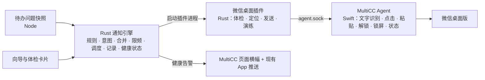

# 微信桌面提醒技术方案（第三版）

版本：第三版，2026 年 10 月 28 日，取代第二版。

状态：设计稿，尚未实现。标“已有”的内容已对照当前代码或本机状态核实，并给出位置；标“拟新增”的为提案。仓库路径相对于项目根目录。

## 一、结论

1. **只做一个渠道。** 渠道就是“控制电脑操作微信桌面版”，只支持 macOS。不接企业微信、第三方转发（Server 酱、PushPlus 等）或 iLink。
2. **发送交给确定性程序，不再交给大模型。** 由 Rust 写的“微信桌面插件”编排每一步，MultiCC Agent 负责执行。每一步都用本机文字识别核对屏幕，任何一处对不上就停手。发送过程不调用模型，截图也不离开本机。
3. **三个难点各自成套：**
   - **配置引导**：一个四步向导。每个检查项都有状态、原因、一键处理和“重新检测”。最后真实发一条测试消息，并由你在手机上确认收到、确认有提醒声。
   - **危险检测**：分三层，分别是发送前体检、发送中逐步核对、后台持续巡检。巡检发现的问题通过 MultiCC 页面和现有的 App 推送告诉你，不用微信报微信自己的故障。
   - **锁屏**：把“锁屏发送能力”分成四档显示。需要锁屏发送时，按“解锁 → 发送 → 立即重新锁屏 → 确认已锁回”执行。解锁失败一次就停用这项能力，避免反复尝试错误密码。
4. **有一个前提必须先讲清。** Mac 上登录的是哪个微信号，消息就以哪个号的身份发出。自己发出的消息，自己的手机通常不会响铃提醒。所以想提醒自己，Mac 上应登录一个专用小号，由它发给你的主号或者含主号的群。
5. **本期范围。** 提醒规则和投递沿用第二版的精简引擎（Rust）。“现有推送全部迁入引擎”这件事移出本期，现有推送照常工作。

## 二、与第二版的差异

| 第二版 | 第三版 | 原因 |
| --- | --- | --- |
| 统一通知管道，现有推送分阶段迁入 | 只做微信桌面；现有推送不迁移，只用来报告健康问题 | 用户决定只做控制电脑的微信操作 |
| webhook 模板、企业微信应用消息为首批渠道 | 不做 | 同上 |
| 桌面中转为实验性，结果只到“已交给中转” | 桌面发送是主线，改为确定性发送器，结果可到“已在微信提交” | 现有中转靠大模型看截图、坐标写死、会覆盖剪贴板，还会把截图发给模型服务商 |
| “仓库没有桌面互斥” | 更正：Agent 有会话级租约，同一时刻只允许一个会话操作键鼠 | `scripts/macos-agent/MultiCCAgent.swift:1137`、`:1247` |
| 配置、危险、锁屏只写了几行 | 这三块各占一节，是本方案的主体 | 用户确定的核心难点 |

## 三、现状

### 3.1 MultiCC Agent（`scripts/macos-agent/MultiCCAgent.swift`）

已有能力：

| 能力 | 位置 | 说明 |
| --- | --- | --- |
| 状态查询 | `:1501` | 辅助功能、屏幕录制、事件发送三项权限；是否锁屏；是否已存解锁密码；关盖守卫；控制状态 |
| 请求权限 | `:1519` | 打开系统设置中对应的权限页 |
| 锁屏判定 | `:339` | 依据 `CGSSessionScreenIsLocked` |
| 自动解锁 | `:639` | 用辅助功能把密码填进锁屏密码框并提交，再确认已解锁；未允许、无密码、钥匙串未授权时拒绝 |
| 是否允许自动解锁 | `:363` | 开了“关盖运行”即允许，否则看“允许自动解锁”设置 |
| 会话租约 | `:1137`、`:1247` | 120 秒租约，期间别的会话收到 busy；`release` 可提前释放（`:1524`） |
| 操作闸门 | `:1247` | 未授权、已锁屏、按过 Esc、别的会话占用、受保护应用（系统设置、钥匙串、登录窗口等，`:1234`）都会拒绝；单次操作最多排队 15 秒 |
| 输入文字 | `:159` | 用 Unicode 键盘事件输入中文，不经过剪贴板 |
| 无障碍树查看 | `see` | 对微信无效：微信几乎不暴露界面元素 |

缺少的能力：

| 能力 | 现状 |
| --- | --- |
| 文字识别 | 没有。`click-text` 只匹配无障碍树里的文字，而微信不暴露这些文字 |
| 重新锁屏 | 没有这个操作 |
| 判断真人是否在用电脑 | 没有。`:985` 的注释写明，Agent 有意不把键鼠活动当作“用户在用”，因为它分不清自己的操作和真人操作 |
| 保留剪贴板的粘贴 | 没有 |
| 识别微信状态 | 没有 |

### 3.2 自动解锁与电源（已有）

- **接口**：`GET /api/settings/power` 在 `src/routes/host-read.js:255`；自动解锁开关在 `src/routes/host-power.js:47`；“确认授权”在 `:87`。
- **钥匙串授权探测**：由 `src/macos-unlock-probe.js` 实现，有四种状态：已授权、等你在系统框里点“始终允许”、没有密码、Agent 不可用。
- **设置入口**：只在 Web 的 Air 全局设置里。App 端没有这两项设置。

### 3.3 现有微信中转（`~/.multicc/wechat-alert/`）

| 问题 | 依据 |
| --- | --- |
| 窗口位置写死，挪动就停 | `relay-prompt.md:24`：屏幕逻辑分辨率 1470×956，窗口必须是 109,182,941,640 |
| 搜索结果按固定行点击，换个搜索词就得重新量 | `relay-prompt.md:58-62` |
| 核对群名靠模型看截图 | 微信聊天截图会发给模型服务商 |
| 粘贴会覆盖剪贴板，且不恢复 | `relay-prompt.md:90` |
| 每条消息都消耗一次模型调用 | 中转是完整的模型会话 |
| 模型会改写自己的提示词 | 2026-09-27 换群时发生过 |

### 3.4 本机实况（2026-10-28 只读查看）

- 定时规则 `cron_pd7tafzgciuq`（异常任务微信提醒）已停用，最后一次运行在 2026-10-17 14:19。**目前没有任何微信提醒在运行。**
- 停用前的发送记录里，同一个整点运行的任务每小时出错一次、就提醒一次。新方案需要“重复出错抑制”。
- Agent 的三项权限当前全部为 `false`。Agent 日志显示，10 月 26 日之前每次启动都是 `true`，最近两次启动变成了 `false`。Agent 是临时（ad-hoc）签名，重新编译后，系统会把它当成一个新程序，之前给的授权随之失效。
- 解锁密码已存进钥匙串，但“允许自动解锁”和“关盖运行”都是关闭状态。

结论：照现在的状态发起一次锁屏发送，第一步就会失败，而且没有任何地方提前告诉你。第六节的后台巡检就是为这种情况设计的。

## 四、架构



| 组件 | 负责 | 不负责 |
| --- | --- | --- |
| Node | 待办快照、HTTP 接口、向导页面，把健康告警交给现有推送 | 发送逻辑 |
| Rust 通知引擎 | 规则、意图、合并、限频、投递状态、健康状态、调度插件 | 微信界面知识 |
| 微信桌面插件（Rust） | 所有和微信界面有关的知识：关键词、区域比例、版本适配、发送步骤 | 判断该不该提醒 |
| MultiCC Agent（Swift） | 通用能力：文字识别、点击、粘贴、解锁、锁屏、状态 | 认识微信 |

几个取舍：

- **为什么做成插件，而不是写进 Agent**：微信界面会随版本变化，插件可以单独升级。以后飞书、钉钉桌面版提醒也可以做成同类插件，共用 Agent 的能力。
- **为什么不再用大模型**：危险检测要求结果可预期、可复现；而且发送过程不应把微信截图发给模型服务商。
- **为什么 Agent 用 Swift**：文字识别、锁屏、解锁都依赖 macOS 系统框架，Agent 本来就是 Swift 写的原生组件。后端业务逻辑仍在 Rust，Node 只做接入层。
- **插件怎么被调用**：引擎直接启动插件进程，单次发送上限 60 秒，不经过插件路由的 20 秒限制。插件通过 `agent.sock` 调用 Agent。

## 五、配置引导（难点一）

入口在“设置 → 微信提醒”。首次进入是四步向导；配置完成后，页面顶部常驻一张“体检卡片”。

每个检查项都显示四样东西：状态（通过 / 未通过 / 检测中）、一句话原因、一个处理按钮、“重新检测”。任何一项未通过时，后面步骤里依赖它的操作按钮都不可点，旁边写明原因。

### 第 1 步：电脑准备

| 检查项 | 怎么判断 | 未通过时的提示与操作 |
| --- | --- | --- |
| 系统 | 当前平台 | 只支持 macOS |
| MultiCC Agent 在运行 | Agent 状态查询 | “安装并启动 Agent”按钮，复用现有安装流程 |
| 辅助功能权限 | 状态中的 `accessibility` | “去授权”：打开系统设置对应页面，页面每 2 秒检测一次，变绿即通过 |
| 屏幕录制权限 | `screenRecording` | 同上 |
| 事件发送权限 | `postEvents` | 同上 |
| 系统不会睡眠 | `GET /api/settings/power` 中的 `systemSleepDisabled` | 说明 Mac 睡眠时 MultiCC 本身不运行，什么都发不出 |
| 锁屏发送能力 | 第七节的分档 | 显示当前档位，以及升到下一档还缺哪一项 |

授权项旁边常驻一句提示：“MultiCC Agent 更新后，可能需要重新授权。”

### 第 2 步：微信准备

| 检查项 | 怎么判断 | 未通过时 |
| --- | --- | --- |
| 微信已安装 | 应用是否存在 | 引导安装 |
| 微信在运行 | 主进程是否存在 | “启动微信”按钮 |
| 已登录 | 插件体检：根据窗口尺寸，加上文字识别关键词，区分登录页、主界面、更新弹窗 | 提示去 Mac 上扫码登录；这一步无法代办 |
| 微信版本 | 读取应用版本 | 未验证的版本显示“未验证，建议先演练” |
| 发送键 | 让你选择“Enter 发送”还是“⌘+Enter 发送”，第 3 步的测试发送会核实 | 测试未通过，就提示到微信设置里核对 |

**发送账号说明**（必须阅读并勾选“我已了解”才能继续）：

- Mac 上登录的是哪个微信号，消息就以哪个号的身份发出。
- 自己发出的消息，自己的手机通常不会响铃提醒。
- 推荐用法：

  | 用法 | 适合谁 | 说明 |
  | --- | --- | --- |
  | A：Mac 登录小号，发给你的主号（私聊） | 想提醒自己的个人用户 | 推荐 |
  | B：Mac 登录小号或团队成员的号，发到团队群 | 团队 | 推荐 |
  | C：Mac 登录你的主号，发到群 | — | 别人会收到，你自己的手机不会响，不适合提醒自己 |

- 风险提示：自动操作微信可能不符合微信的使用规则，存在账号被限制的风险。建议使用小号。本功能默认低频发送（见第九节）。

### 第 3 步：选择接收人

1. **搜索**：你输入接收人名称，插件在微信里搜索，返回候选列表，每项包括分类（群聊或联系人）、名称、截图裁剪。
2. **点选**：只接受精确同名且唯一的结果。
   - 出现同名或名称互相包含时，不允许“选第一个”。
   - 这时提示你给群改一个唯一名称，或者换一个接收人。
3. **记录绑定**：名称、类型、识别出的标题文字、群人数后缀规则（例如 `(5)`）、绑定时的截图。
4. **测试发送**：发出一条“【测试】MultiCC 微信提醒 编号 xxxx”，全程按第八节的流程核对。
5. **手机确认**：页面询问“你的手机收到了吗？”，提供三个按钮：

   | 你的回答 | 处理 |
   | --- | --- |
   | 收到了，有提醒声 | 接收人标记为“已确认送达” |
   | 收到了，但没响 | 大概率是发送号和接收号是同一个，回到第 2 步的账号说明 |
   | 没收到 | 显示这次发送每一步的记录和截图，供排查 |

这个手机确认，是整个方案里唯一能证明“真的送到人”的环节。

### 第 4 步：提醒规则

| 设置 | 默认值 |
| --- | --- |
| 提醒类别 | “出错了”“在等你回答”开；“需要交互”关 |
| 范围 | 全部项目，可改为指定项目或排除某些任务 |
| 你在电脑前时不发 | 开。屏幕未锁、且键鼠空闲不到 5 分钟时，就认为你在电脑前 |
| 静默时段 | 关，可设置 |
| 合并等待 | 60 秒 |
| 同一接收人最短间隔 | 5 分钟 |
| 发送上限 | 每小时 6 条，每天 40 条 |
| 重复出错抑制 | 同一任务 6 小时内再次出错，不再提醒 |
| 消息里带链接 | 关；需先配置手机能访问的地址 |

**新规则默认先演练 1 天。** 演练会真实操作到“核对接收人”这一步为止，不粘贴、不发送，每次都留下记录。演练成功率达标后，由你点“转为正式”。演练同样只在你离开电脑时进行。

**启用规则时只登记当前已有的问题，不补发。**

### 体检卡片（常驻）

| 内容 | 显示什么 |
| --- | --- |
| Agent 与权限 | 是否在运行，三项权限 |
| 微信 | 登录状态、版本 |
| 锁屏发送能力 | 当前档位 |
| 最近一次发送 | 结果和时间 |
| 最近一次演练 | 结果和时间 |
| 巡检 | 下次巡检时间 |

任一项变红：页面顶部出现横幅，并通过现有 App 推送告诉你（见 6.4）。

## 六、危险检测（难点二）

分三层：

| 层 | 什么时候 | 解决什么 |
| --- | --- | --- |
| 发送前体检 | 每次发送前 | 现在适不适合动这台电脑 |
| 发送中逐步核对 | 每一步操作后 | 有没有点错、发错 |
| 后台持续巡检 | 不发送时也在跑 | 提前发现“到时候会发不出” |

### 6.1 发送前体检

每次发送前跑一遍，耗时约 1 秒，不操作键鼠。

| 危险 | 检测 | 处理 |
| --- | --- | --- |
| Agent 不在，或权限缺失 | Agent 状态 | 标为“需要你处理”，并触发巡检告警 |
| 你正在用电脑 | 屏幕未锁，且硬件键鼠空闲不足 5 分钟（拟新增 `humanIdleSeconds`，在 Agent 发出任何操作前读取） | 推迟到你离开；推迟期间问题已解决的，就不再发 |
| 你在远程控制这台 Mac，或别的会话在操作电脑 | Agent 租约持有者 | 推迟 |
| 你按过 Esc，或点了暂停条 | Agent 控制状态 | 推迟并提示；不自行恢复 |
| 前台是会议或投屏应用 | 前台应用名单（腾讯会议、飞书会议、钉钉会议、Zoom、Teams 等，可配置） | 推迟，避免在共享屏幕时弹出微信 |
| 刚开机还没登录，或切换到了别的 macOS 用户 | 当前控制台用户 | 跳过，标为“需要你处理” |
| 屏幕锁着 | 见第七节 | 见第七节 |
| 微信未运行、未登录、有弹窗、版本未验证 | 插件体检 | 未运行时尝试启动一次；其余情况标为“需要你处理” |
| 超出频率、每日上限，或处于静默时段 | 引擎 | 推迟 |

### 6.2 发送中逐步核对

每一步之前都检查 Esc 和暂停条。

| 步骤 | 核对内容 | 不通过时 |
| --- | --- | --- |
| 1. 激活微信 | 前台是微信主进程，窗口在屏幕上；窗口位置每次实时读取，不写死 | 停手 |
| 2. 搜索接收人 | 同一分类下恰好有一个精确同名的结果 | 停手（找不到或不唯一） |
| 3. 进入会话 | 标题识别结果等于绑定名称（忽略人数后缀） | 停手 |
| 4. 草稿检查 | 输入框识别为空 | 停手，原因：“输入框里有你还没发出的草稿，为免一起发出已停止” |
| 5. 粘贴 | 先保存剪贴板、粘贴、再恢复剪贴板；输入框识别出正文首行和编号 | 清掉刚粘贴的内容后停手 |
| 6. 发送前复核 | 再核对一次前台应用和会话标题 | 清掉粘贴内容后停手 |
| 7. 按发送键 | **提交点** | — |
| 8. 发送后核对 | 聊天区最后一条消息里识别出本次编号 | 识别到为“已在微信提交”，否则为“结果不明” |
| 9. 恢复现场 | 恢复原来的前台应用，恢复微信原来是否隐藏；原来锁着的重新锁屏（第七节） | 恢复失败要记录；锁屏失败为最高级告警 |

重试规则：

- **在提交点之前失败**：可以确定没发出，允许自动重试。最多 3 次，并且只在你离开电脑时重试。
- **在提交点之后**：一律不自动重试。“结果不明”的投递附上截图，由你决定是否重发。

还有一项待验证：发送过程中如果检测到真人动了键鼠（硬件事件的空闲时间被重置），立即停手。Agent 自己发出的操作会不会干扰这个读数，需要第零阶段实测。实测不可靠的话，只保留发送前判断和 Esc。

### 6.3 发送器的硬性限制

- 只往绑定的接收人发，只发引擎给出的定稿正文。
- 不点击其他会话里的任何东西，不打开链接、不处理文件、不改微信设置。
- 窗口、标题、搜索结果，任何一处与预期不符，就停手，不尝试“绕过去”。
- 每一步的截图都保存在本机私有目录，保留 7 天；文字识别在本机完成。

### 6.4 后台持续巡检

**什么时候巡检**：
- MultiCC 启动时；
- 每 15 分钟一次；
- Mac 唤醒或解锁后；
- Agent 版本或签名变化后；
- 微信版本变化后。

**检查什么**：
- Agent 是否在运行，三项权限；
- 解锁密码是否已存、钥匙串是否已授权、是否允许自动解锁；
- 关盖运行是否打开、当前盖子状态；
- 微信是否登录；
- 系统睡眠设置。

**怎么告警**：
- 通过 MultiCC 页面横幅和现有 App 推送（网页推送、FCM、Bark）。
- 同一个问题只告警一次，恢复后再出现才会再次告警。
- **不用微信报微信的故障。**

第 3.4 节的权限丢失就是典型场景：Agent 重编后授权失效，巡检应在 15 分钟内发现，并推送到你的手机。根本的解决办法是给 Agent 一个稳定的开发者签名，这不在本方案范围内，列为风险。

### 6.5 账号风控

- 默认低频（见第五节第 4 步）。
- 多个任务合并成一条消息，相同内容不重复发送。
- 默认不带外部链接。
- 发送行为保持固定节奏，只发给绑定的接收人。

## 七、锁屏、熄屏与自动解锁（难点三）

### 7.1 锁屏发送能力分四档

| 档位 | 含义 | 需要的条件 |
| --- | --- | --- |
| 不可用 | 发不出去 | 原因可能是：Agent 权限缺失、系统会睡眠、微信不可用 |
| 一档 | 只在屏幕未锁时发 | 第五节第 1、2 步全部通过 |
| 二档 | 锁屏时也能发 | 允许自动解锁已打开；解锁密码已存；钥匙串状态为“已授权”；锁屏实测通过 |
| 三档 | 合上盖子也能发 | 二档的条件，加上“关盖运行”已打开（合盖时 Agent 关掉背光，桌面保持可以操作） |

页面显示当前档位、还缺哪一项，以及对应的按钮。这些按钮直接复用 Air 全局设置里已有的“自动解锁”“确认授权”“关盖运行”。

### 7.2 状态怎么判断

| 状态 | 判断依据 | 注意 |
| --- | --- | --- |
| 是否锁屏 | 只看 `CGSSessionScreenIsLocked` | 屏幕亮着时，锁屏界面的截图并不是黑的，不能拿截图判断 |
| 屏幕是否熄灭 | 电源断言 | 熄屏时截图是黑帧 |
| 盖子是否合上 | `AppleClamshellState` | — |
| 系统是否睡眠 | — | 系统睡眠时 MultiCC 本身不运行，只能靠“系统不睡眠”的设置来保证 |

### 7.3 锁屏发送流程

1. 记录原始状态：是否锁屏、是否熄屏、背光、当前前台应用。
2. 屏幕熄灭时先唤醒。
3. 调用 Agent 现有的解锁能力，并确认已经解锁。
4. 执行第六节 6.2 的发送流程。
5. **无论发送成功与否，立即重新锁屏**（拟新增 `lock` 能力），并确认已锁回。
6. 恢复熄屏和背光状态。

从解锁到锁回，目标控制在 30 秒以内。**原来是锁着的，就一定锁回去**，即使发送中途有人动了电脑也一样：解锁这件事必须由人自己来做。

### 7.4 失败处理

| 情况 | 处理 |
| --- | --- |
| 解锁后仍是锁屏（密码可能改了） | 只尝试这一次。立即停用锁屏发送，告警“解锁密码可能已变更，请到设置里重新保存”。不重试，以免触发系统对密码输错的等待惩罚 |
| 钥匙串未授权 | 标为“需要你处理”，提示到设置里点“确认授权” |
| 没有解锁密码，或未允许自动解锁 | 能力降到一档；锁屏期间的提醒推迟到你下次解锁后 |
| **重新锁屏失败** | 最高级告警：这台 Mac 处于解锁状态。立即发 App 推送，并每分钟重试锁屏直到成功 |

### 7.5 安全提示

开启二档、三档前，必须展示以下说明并确认：

- 自动解锁意味着 MultiCC 可以用你的登录密码解锁这台 Mac。
- 解锁的十几秒里，旁边的人能看到屏幕内容。合盖时背光是关的，这个风险会小很多。
- 只建议在你信任的环境下开启。
- 登录密码只保存在系统钥匙串里，不进入 MultiCC 的保险箱。

### 7.6 锁屏实测（向导按钮）

- **锁屏实测**：点“锁屏实测”后，Agent 立即锁屏；10 秒后，对绑定的接收人做一次测试发送（解锁 → 发送 → 锁回）；页面列出每一步的结果。通过后，能力才标为二档。
- **合盖实测**：提示你合上盖子 1 分钟再打开，然后查看结果。通过后标为三档。

## 八、发送器设计

### 8.1 Agent 拟新增的通用能力

这些能力都沿用现有闸门：租约、Esc、受保护应用。

| 能力 | 说明 |
| --- | --- |
| `ocr` | 对指定窗口或区域做文字识别，返回文字和位置。使用系统 Vision 框架，在本机完成 |
| `paste` | 一次完成：保存剪贴板 → 写入文本 → ⌘V → 恢复剪贴板 |
| `lock` | 立即锁屏，并确认已经锁上 |
| 窗口截图 | 按窗口编号截图，被其他窗口遮挡也能截到 |
| 状态新增字段 | `humanIdleSeconds`（硬件键鼠空闲秒数）、当前控制台用户、前台应用 |

### 8.2 插件命令（`plugins/wechat-desktop-notify/`）

| 命令 | 输入 | 输出 |
| --- | --- | --- |
| `describe` | — | 支持的平台、已验证的微信版本 |
| `probe` | — | 微信是否在运行、是否登录、有无弹窗、版本、窗口位置 |
| `locate` | 名称 | 搜索候选列表（含截图裁剪），用于第五节第 3 步 |
| `send` | 投递编号、尝试编号、接收人绑定、正文、发送键、是否允许解锁 | 结果、是否越过提交点、每一步的记录、证据截图路径 |
| `rehearse` | 同 `send` | 只执行到核对接收人为止，不粘贴、不发送 |

### 8.3 关键做法

- **不写死位置**：窗口位置每次实时读取。点击坐标由“识别出的文字位置”或“窗口内的相对比例”算出；搜索结果按识别出的文字定位。
- **占住、用完即还**：第一步就占住 Agent 的租约，全程使用同一个会话名，结束后立即释放，而不是让租约空占 120 秒。
- **时间上限**：单次发送整体不超过 60 秒。超时后，按是否越过提交点来判定结果。
- **版本适配**：插件内置一张“已验证版本 → 界面关键词与区域”的表。遇到未知版本仍可尝试，但会先要求演练。

## 九、提醒规则与投递（精简引擎）

### 9.1 提醒来源

- 来源是“待办问题”快照，复用 `src/workspace/air-routes.js:193` 的 `todoProblemOf`。
- 每个提醒意图由“任务 + 类别 + 本次问题发生时刻”唯一确定。
- 默认排除：
  - 用户主动取消的任务；
  - 服务重启打断的回合（`cancel_shutdown`，见 `src/chat/api-error-policy.js:482`）；
  - 已归档的任务。
- **新增“重复出错抑制”**：同一任务在设定时间内（默认 6 小时）再次出错，不再提醒。依据是第 3.4 节：同一个整点任务曾经每小时提醒一次。

### 9.2 投递状态

| 状态 | 你看到的含义 |
| --- | --- |
| `queued` | 已排队 |
| `deferred` | 推迟中，并附原因：你在用电脑、静默时段、桌面被占用、频率限制、锁屏但未开自动解锁 |
| `sending` | 正在发送 |
| `submitted` | 已在微信提交（附截图） |
| `blocked` | 需要你处理（附具体原因和处理按钮） |
| `unknown` | 结果不明，可能已发出（附截图，由你决定是否重发） |
| `failed` | 明确失败或已达重试上限 |
| `cancelled` | 已取消：问题已解决、已忽略、已过期或规则已停用 |

### 9.3 消息格式

```
⚠️ MultiCC · 2 个任务要看一下
【出错了】1 个
· GMV Max小时刷新与妙搭同步
【在等你回答】1 个
· README更新远程核对与发布检查
时间 10-28 14:18 · 编号 a3f9
```

- 编号是本次投递的短码，用于发送后在聊天记录里识别出这条消息。
- 发送前再复核一次：已经解决的问题从正文中剔除；全部解决了就取消这次投递。

## 十、数据与接口

### 10.1 数据表

数据库：`${数据根目录}/notifications/notifications.sqlite`。新的写入位置要登记到 `governance/runtime-write-inventory.json`，证据截图目录也一样。

| 表 | 内容 |
| --- | --- |
| `targets` | 接收人绑定：名称、类型、标题文字、绑定截图、发送键、是否已确认送达、版本号 |
| `rules` | 规则：类别、范围、时机、频率、演练或正式、基线时刻 |
| `intents` | 提醒意图：任务、类别、发生时刻、状态 |
| `deliveries` | 投递：接收人、正文快照、状态、推迟原因、下次执行时刻 |
| `delivery_items` | 投递和意图的对应关系 |
| `attempts` | 每次尝试：每一步的记录、是否越过提交点、证据路径、错误原因 |
| `health` | 体检项：状态、原因、首次失败时间、最近检查时间、是否已告警 |

### 10.2 接口（拟新增）

| 方法与路径 | 行为 |
| --- | --- |
| `GET /api/notifications/health` | 体检卡片数据与锁屏发送档位 |
| `POST /api/notifications/health/check` | 立即重新检测 |
| `POST /api/notifications/targets/search` | 在微信里搜索候选接收人 |
| `POST /api/notifications/targets` | 保存接收人绑定 |
| `PATCH /api/notifications/targets/:id` | 修改或停用接收人 |
| `POST /api/notifications/targets/:id/test` | 测试发送 |
| `POST /api/notifications/targets/:id/confirm` | 记录手机确认结果 |
| `POST /api/notifications/lock-test` | 锁屏实测 |
| `GET` / `POST /api/notifications/rules` | 查看或新建规则 |
| `PATCH /api/notifications/rules/:id` | 修改、演练转正式、暂停 |
| `GET /api/notifications/deliveries` | 发送记录（含每一步的记录） |
| `POST /api/notifications/deliveries/:id/retry` | 重试；结果不明的投递需要你确认“可能重复” |
| `POST /api/notifications/deliveries/:id/cancel` | 取消 |
| `PATCH /api/notifications/switch` | 总开关 |

## 十一、实施阶段

| 阶段 | 内容 | 完成判据 |
| --- | --- | --- |
| 第零阶段：验证（约 2 天） | 见下方清单 | 结论写入本文，据此调整第六、七节 |
| 第一阶段：体检与巡检 | Agent 新增 `ocr`、`lock`、`humanIdleSeconds`、`paste`；插件 `probe`；引擎的健康状态与巡检；向导第 1、2 步与体检卡片 | 本机现在这种权限丢失，能在 15 分钟内被发现并推送到手机；每个检查项都能一键跳到处理位置 |
| 第二阶段：发送（屏幕未锁） | 插件 `locate` / `send` / `rehearse`；精简引擎；向导第 3、4 步；演练模式；发送记录 | 测试发送并经手机确认；演练 1 天成功率达到 95% 以上；第十二节第二阶段用例全部通过 |
| 第三阶段：锁屏与合盖 | 解锁 → 发送 → 锁回；四档能力显示；锁屏实测与合盖实测 | 第十二节第三阶段用例全部通过；锁回失败的告警实测可达 |
| 第四阶段：正式启用 | 由你选定接收人，演练转正式 | 运行一周没有发错、没有漏锁回。旧定时规则和中转任务保持停用，由你决定是否归档 |

第零阶段验证清单：

1. **文字识别准确率**：在浅色和深色模式下，Vision 对微信标题、搜索结果、输入框、聊天气泡的识别准确率，含中文和英文群名。
2. **微信界面**：当前版本的搜索快捷键；登录页、主界面、更新弹窗的识别特征；发送键设置；输入框是否为空的判断方法。
3. **重新锁屏**：哪种锁屏方法可靠，以及“解锁 → 发送 → 锁回”在开盖、合盖两种情况下能否走通。
4. **真人键鼠检测**：Agent 自己发出的操作，会不会重置硬件键鼠的空闲时间。
5. **自己发自己**：本号发出的消息，本人手机是否真的不响。
6. **耗时**：单次发送耗时，以及屏幕处于解锁状态的时长。

## 十二、验收

| 阶段 | 场景 | 必须观察到 |
| --- | --- | --- |
| 一 | Agent 权限被收回 | 15 分钟内页面横幅出现、手机收到推送，同一问题只告警一次 |
| 一 | 微信退出登录 | 巡检发现后显示“需要你处理”，不尝试发送 |
| 二 | 你正在用电脑时出现新问题 | 推迟；你离开 5 分钟后发出；推迟期间问题已解决的不发 |
| 二 | 输入框里有你的草稿 | 停手，草稿保持原样，没有发出任何内容 |
| 二 | 搜索结果有两个同名群 | 停手，状态为“需要你处理”，原因写明“接收人不唯一” |
| 二 | 微信窗口被挪动或改变大小 | 照常发送 |
| 二 | 发送前一刻前台被切走 | 清掉粘贴内容后停手，不发出 |
| 二 | 发送前后的剪贴板 | 内容与发送前一致 |
| 二 | 按下发送键后，没识别到编号 | 状态为“结果不明”并附截图，不自动重发 |
| 二 | 30 秒内 5 个任务出错 | 只发 1 条合并消息 |
| 二 | 同一整点任务连续 3 小时出错 | 只提醒 1 次 |
| 二 | 按 Esc 或点暂停条 | 立即停手，不自行恢复 |
| 二 | 会议应用在前台 | 推迟 |
| 二 | 发送全过程 | 没有任何截图发往模型服务商，没有调用模型 |
| 三 | 锁屏时出现问题 | 解锁 → 发送 → 锁回，锁回后确认是锁屏状态 |
| 三 | 解锁密码已更改 | 只尝试一次，停用锁屏发送并告警 |
| 三 | 锁回失败（模拟） | 立即推送最高级告警，并每分钟重试锁屏 |
| 三 | 合盖并开启关盖运行 | 能发送，背光始终保持关闭 |
| 三 | 未开自动解锁时锁屏 | 推迟到你解锁后再判断是否还需要发送 |

## 十三、风险与待定

| 风险 | 应对 |
| --- | --- |
| 自动操作微信可能违反其使用规则，账号可能受限 | 向导里明确说明；建议用小号；默认低频 |
| 微信界面随版本变化 | 已验证版本表；未知版本先演练；巡检发现版本变化后自动安排一次演练 |
| Agent 临时签名，重编后权限失效 | 巡检及时发现并提示重新授权；长远需要稳定签名 |
| 自动解锁的安全代价 | 显式确认；一定锁回；锁回失败最高级告警；建议合盖使用 |
| 真人键鼠检测可能不可靠 | 第零阶段验证；不可靠就只保留发送前判断和 Esc |
| 发送账号和接收账号是同一个 | 向导强制说明，测试发送后由手机确认 |
| 文字识别误判导致发错 | 搜索结果、标题、输入框三重核对；任何一处不符即停手 |

**待你决定**：接收人怎么选？

- 推荐个人用户：小号发给主号私聊。
- 推荐团队：发到团队群。
- 原来的群「all in one」：要看 Mac 上登录的是哪个号。如果是你本人的号，你自己的手机不会响。

## 十四、拟改动文件

| 文件或目录 | 改动 |
| --- | --- |
| `scripts/macos-agent/MultiCCAgent.swift`（可另拆文件） | 拟新增 `ocr`、`paste`、`lock`、窗口截图，以及状态新增字段 |
| `plugins/wechat-desktop-notify/` | 拟新增 Rust 插件：清单、源码、说明、平台产物 |
| `.gitignore` | 加入 `!/plugins/wechat-desktop-notify/`，否则插件不会被提交 |
| 插件构建与打包脚本 | 纳入新插件 |
| `native/core/src/notifications/`、`native/addon/src/notifications.rs` | 精简引擎、健康状态、插件调度 |
| `src/native/notifications.js`、`src/notifications/host.js` | 薄桥接；把待办快照交给引擎；把健康告警交给现有推送 |
| `src/routes/notifications.js` | 第十节的接口 |
| `src/workspace/air-routes.js` | 导出待办快照 |
| `src/paths.js`、`governance/runtime-write-inventory.json` | 新增数据库和证据目录的路径与登记 |
| `public/` | 向导、体检卡片、发送记录、横幅 |
| `app/` | 首版只确保能收到健康告警推送；向导只做 Web |
| 测试 | Agent 新能力、插件模拟测试、引擎测试、向导交互测试；新测试必须写进 `package.json` 的测试脚本 |

本轮只完成方案设计：没有修改代码，没有改动或启用任何提醒规则，没有发送消息，没有锁屏或解锁，也没有重启服务。
